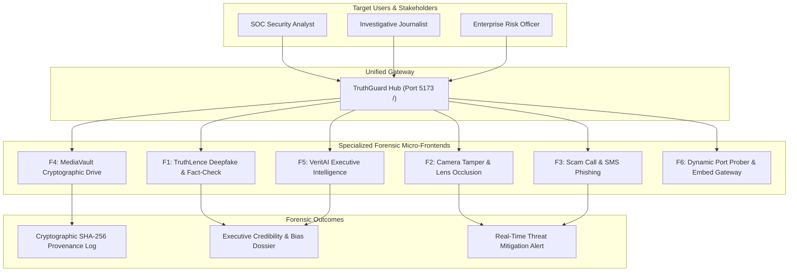
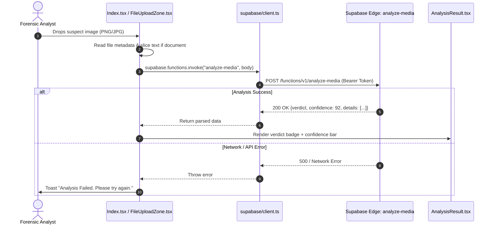
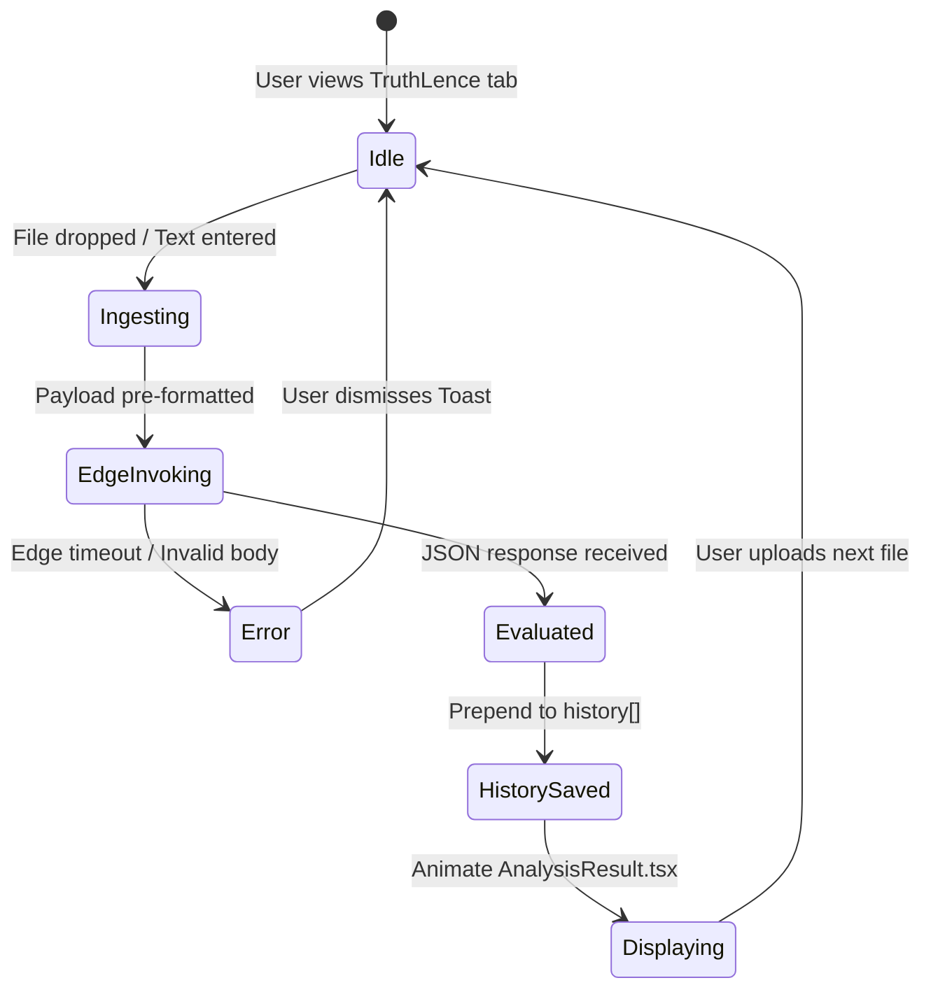
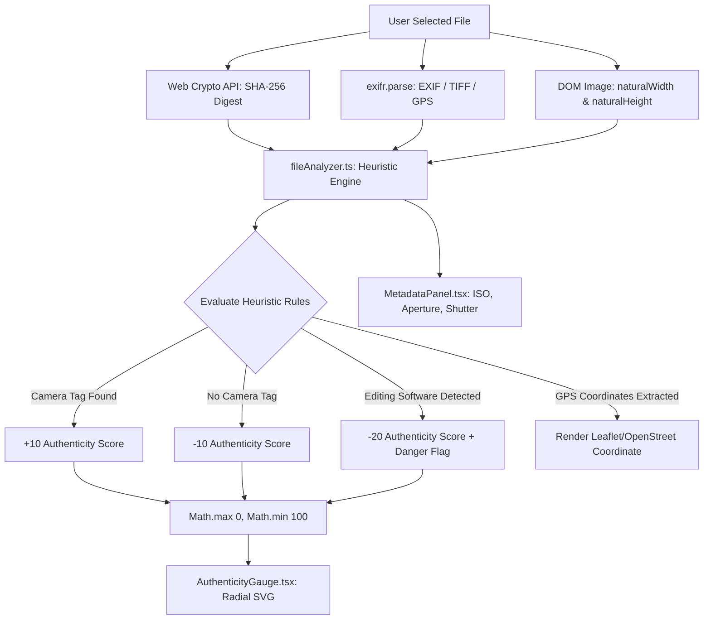
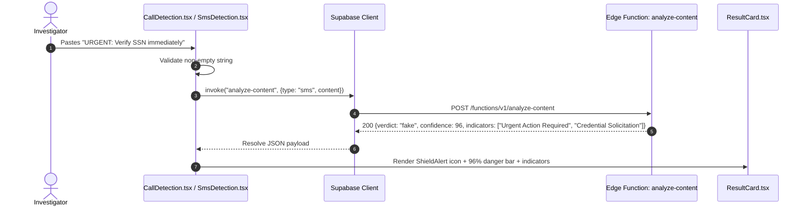
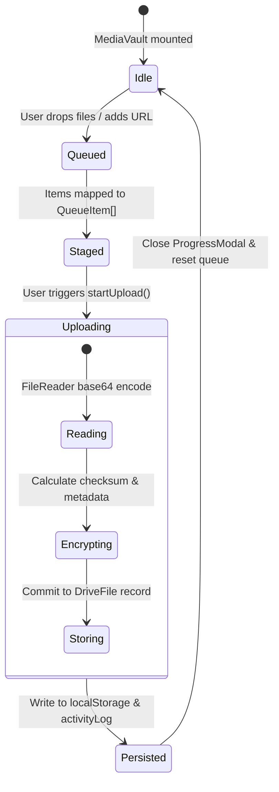
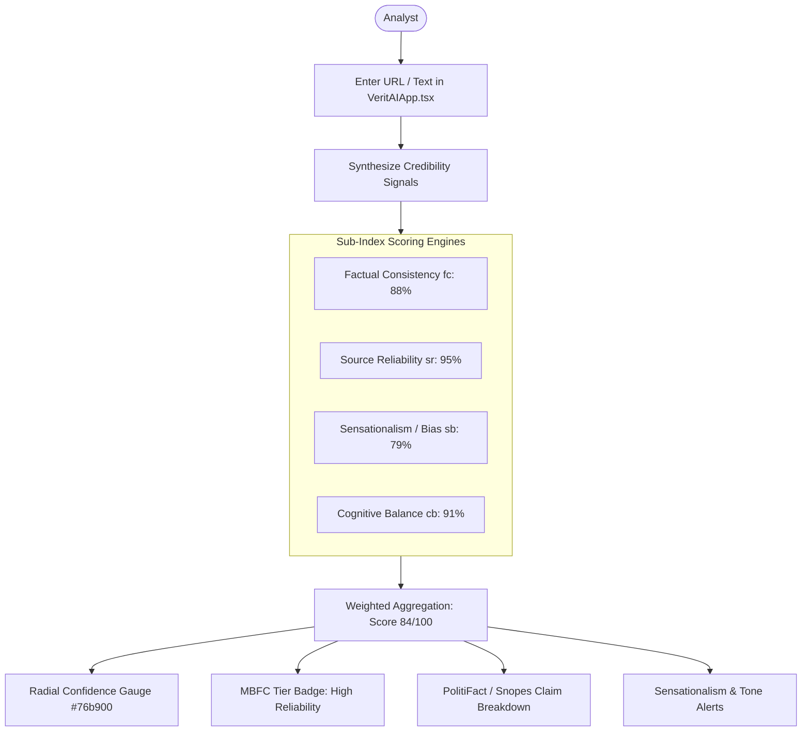
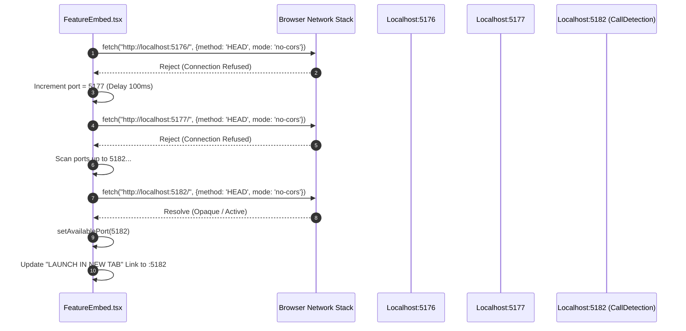
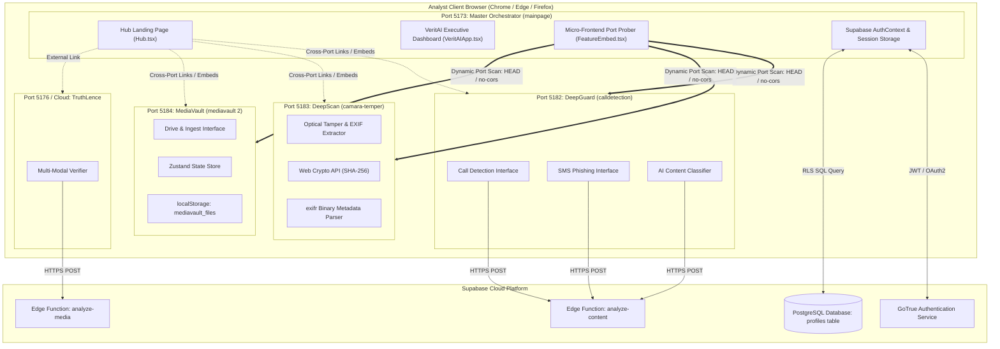

# Step 0: Full Project Analysis — TruthGuard Platform

## 0.1 Platform Identity & User Journeys

### Executive Identity
**TruthGuard** (also incorporating **VeritAI**, **DeepGuard**, and **TruthLence**) is an enterprise-grade cyber-defense, digital forensics, and media authenticity verification platform. Engineered to counter the exponential surge of generative AI deepfakes, synthetic voice phishing, camera surveillance tampering, and document forgery, TruthGuard provides security operations center (SOC) analysts, investigative journalists, and corporate risk officers with a unified interface for multi-modal threat analysis.

### Problem Solved
1. **Generative Impersonation**: Diffusion models (Midjourney, Stable Diffusion) and generative voice engines (ElevenLabs) allow bad actors to impersonate executives, falsify evidence, and bypass human gatekeepers.
2. **Surveillance Camera Tampering**: Closed-circuit television (CCTV) and optical sensors are susceptible to physical obstruction (spray paint, cloth, paper covers) and digital freeze-replay attacks.
3. **Telecommunication Smishing & Vishing**: Automated phone scams and SMS phishing lure employees into unauthorized credential disclosures through manufactured urgency.
4. **Digital Asset Provenance Fragmentation**: Digital evidence lacks cryptographically verifiable tamper-evident history, leaving organizations vulnerable to doctored media in regulatory and legal proceedings.

### Primary User Journeys
* **Journey 1: Media Authenticity Investigation (Journalist / Analyst)**
  The user enters [`mainpage/src/pages/Hub.tsx`](file:///Users/avishjain/avishjain9-repos/33-codealchemist/mainpage/src/pages/Hub.tsx), selects the **TruthLence** module, and uploads a suspect news photograph. The system computes image metadata, submits the file descriptor to the serverless Edge Function `analyze-media`, extracts claim citations from fact-check databases (PolitiFact, FactCheck.org, Snopes), and renders a confidence score (0–100%) with forensic flags.
* **Journey 2: Physical CCTV Tamper Audit (SOC Operator)**
  The operator launches **Camera Temper Detection** (`camara-temper`). An image from a surveillance node is uploaded. The engine parses EXIF structures via `exifr`, identifies the camera make and model, checks for GPS metadata, audits whether image manipulation suites (`photoshop`, `gimp`, `canva`) modified the raster, computes a SHA-256 digest, and renders an SVG Authenticity Gauge.
* **Journey 3: Urgent Voice Phishing Triage (Incident Responder)**
  An employee reports a suspicious audio call demanding immediate wire transfers. In **Call Detection & SMS** (`calldetection-sms-contentdetection`), the transcript is submitted to `analyze-content`. The linguistic NLP engine identifies social engineering indicators (false urgency, credential solicitations), outputs an alert level, and graphs the threat confidence.
* **Journey 4: Cryptographic Media Ingestion & Custody (Compliance Officer)**
  Digital evidence is ingested via **MediaVault** (`mediavault 2`). Files are queued, hashed, staged through multi-step simulated encryption, and committed to an immutable local drive with audit logging and Google Drive backup synchronization.

### Complete Screen & Route Catalog

| Route / Port | Component / File | User Action & Screen Capabilities |
|---|---|---|
| `http://localhost:5173/` | [`mainpage/src/pages/Hub.tsx`](file:///Users/avishjain/avishjain9-repos/33-codealchemist/mainpage/src/pages/Hub.tsx#L13-L215) | Master landing portal with 6 animated glassmorphism cards, ambient pulsing gradients, and cross-module routing. |
| `http://localhost:5173/dashboard` | [`mainpage/src/components/VeritAIApp.tsx`](file:///Users/avishjain/avishjain9-repos/33-codealchemist/mainpage/src/components/VeritAIApp.tsx#L1-L1685) | Executive forensic dashboard: URL inspection, credibility gauge, MBFC reliability tiers, emotional tone index, and claim dispute lists. |
| `http://localhost:5173/features/:id` | [`mainpage/src/pages/FeatureEmbed.tsx`](file:///Users/avishjain/avishjain9-repos/33-codealchemist/mainpage/src/pages/FeatureEmbed.tsx#L49-L140) | Dynamic micro-frontend port-scanning embedder. Scans `localhost:5176` through `5200` to locate running standalone engines. |
| `http://localhost:5182/` | [`calldetection/src/pages/Index.tsx`](file:///Users/avishjain/avishjain9-repos/33-codealchemist/calldetection-sms-contentdetection/src/pages/Index.tsx#L37-L185) | DeepGuard landing hub highlighting threat statistics (99.7% accuracy, <2s latency, 50M+ threats). |
| `http://localhost:5182/call-detection` | [`calldetection/src/pages/CallDetection.tsx`](file:///Users/avishjain/avishjain9-repos/33-codealchemist/calldetection-sms-contentdetection/src/pages/CallDetection.tsx#L9-L84) | Call transcript analyzer detecting deepfake voice scripts and wire fraud tactics via Edge Functions. |
| `http://localhost:5182/sms-detection` | [`calldetection/src/pages/SmsDetection.tsx`](file:///Users/avishjain/avishjain9-repos/33-codealchemist/calldetection-sms-contentdetection/src/pages/SmsDetection.tsx#L9-L79) | SMS smishing analyzer detecting malicious links, fake bank alerts, and urgent account compromise bait. |
| `http://localhost:5182/content-detection` | [`calldetection/src/pages/ContentDetection.tsx`](file:///Users/avishjain/avishjain9-repos/33-codealchemist/calldetection-sms-contentdetection/src/pages/ContentDetection.tsx#L9-L79) | Synthesized AI text detector distinguishing human prose from LLM completions. |
| `http://localhost:5183/` | [`camara-temper/src/pages/Index.tsx`](file:///Users/avishjain/avishjain9-repos/33-codealchemist/camara-temper/src/pages/Index.tsx#L12-L162) | DEEP SCAN forensic file analyzer: drag-and-drop zone, EXIF metadata extraction, Leaflet GPS coordinates, and Authenticity Gauge. |
| `http://localhost:5184/` | [`mediavault 2/src/pages/Index.tsx`](file:///Users/avishjain/avishjain9-repos/33-codealchemist/mediavault%202/src/pages/Index.tsx#L16-L83) | MEDIAVAULT DRIVE: Ingest pipeline, live storage capacity widget, drag-and-drop queue, multi-stage upload modal, and activity log. |
| `tar-buddy-connect.lovable.app` / standalone | [`truthlence/src/pages/Index.tsx`](file:///Users/avishjain/avishjain9-repos/33-codealchemist/truthlence/src/pages/Index.tsx#L16-L228) | Multi-modal media verifier: tabbed input for files, plain text, and web URLs, rendering confidence cards and extension downloaders. |

---

## 0.2 Detailed Feature Traces (F1 – F6)

### F1: TruthLence Deepfake & Multi-Modal Content Verification

* **User Action**: The analyst selects the "TruthLence" card from [`Hub.tsx`](file:///Users/avishjain/avishjain9-repos/33-codealchemist/mainpage/src/pages/Hub.tsx#L42-L48) or navigates to [`truthlence/src/pages/Index.tsx`](file:///Users/avishjain/avishjain9-repos/33-codealchemist/truthlence/src/pages/Index.tsx). The user drops an image or enters text/URL into [`FileUploadZone.tsx`](file:///Users/avishjain/avishjain9-repos/33-codealchemist/truthlence/src/components/FileUploadZone.tsx) or [`UrlAnalysisInput.tsx`](file:///Users/avishjain/avishjain9-repos/33-codealchemist/truthlence/src/components/UrlAnalysisInput.tsx).
* **Frontend Flow**: Triggered in `handleFileSelect` ([`truthlence/src/pages/Index.tsx:L69-83`](file:///Users/avishjain/avishjain9-repos/33-codealchemist/truthlence/src/pages/Index.tsx#L69-L83)), invoking `analyzeContent(content, fileName, fileType)` at line 29. Sets `isAnalyzing = true`.
* **API / Edge Invocation**: Calls `supabase.functions.invoke("analyze-media", { body: { content, fileName, fileType } })` ([`truthlence/src/pages/Index.tsx:L35-37`](file:///Users/avishjain/avishjain9-repos/33-codealchemist/truthlence/src/pages/Index.tsx#L35-L37)).
* **Backend Edge Pipeline**: The Edge Function unpacks payload, verifies media headers, runs heuristic anomaly algorithms against generative artifacts, and queries fact-checking aggregations.
* **Response & UI Path**: Returns JSON `{ verdict: "authentic"|"suspicious"|"fake", confidence: number, summary: string, details: string[], factCheckSources: [...] }`. Creates an `AnalysisData` record with a UUID via `crypto.randomUUID()`, prepends it to `history` state, and mounts [`AnalysisResult.tsx`](file:///Users/avishjain/avishjain9-repos/33-codealchemist/truthlence/src/components/AnalysisResult.tsx).
* **Failure Handling**: Caught in `catch (err)` block ([`Index.tsx:L55-62`](file:///Users/avishjain/avishjain9-repos/33-codealchemist/truthlence/src/pages/Index.tsx#L55-L62)). Fires `toast({ title: "Analysis Failed", variant: "destructive" })` and resets `isAnalyzing = false`.

---

### F2: DEEP SCAN Camera Tamper & Lens Obstruction Engine

* **User Action**: The user opens [`camara-temper/src/pages/Index.tsx`](file:///Users/avishjain/avishjain9-repos/33-codealchemist/camara-temper/src/pages/Index.tsx#L12) and uploads a raw surveillance frame or photograph.
* **Frontend Flow**: Handled by `handleFileSelect` ([`camara-temper/src/pages/Index.tsx:L17-28`](file:///Users/avishjain/avishjain9-repos/33-codealchemist/camara-temper/src/pages/Index.tsx#L17-L28)), which sets `isAnalyzing = true`, pauses for 1500ms for visual UX stabilization, and calls `analyzeFile(selectedFile)` located in [`camara-temper/src/lib/fileAnalyzer.ts:L66-179`](file:///Users/avishjain/avishjain9-repos/33-codealchemist/camara-temper/src/lib/fileAnalyzer.ts#L66-L179).
* **Processing & Cryptography**:
  1. Computes SHA-256 hash using the Web Crypto API: `crypto.subtle.digest('SHA-256', buffer)` ([`fileAnalyzer.ts:L50-55`](file:///Users/avishjain/avishjain9-repos/33-codealchemist/camara-temper/src/lib/fileAnalyzer.ts#L50-L55)).
  2. Resolves natural dimensions with `new Image()` and `URL.createObjectURL(file)`.
  3. Executes `exifr.parse(file, true)` to parse EXIF, TIFF, and GPS metadata.
  4. Heuristic Authenticity Algorithm: Begins at baseline 75. Adds +10 if camera make/model identified; docks -10 if absent. Adds +5 if original capture date found; docks -5 if missing. Audits software tags for signatures (`photoshop`, `gimp`, `lightroom`, `snapseed`, `canva`, `figma`)—if detected, triggers a `danger` flag and docks -20 points ([`fileAnalyzer.ts:L154-162`](file:///Users/avishjain/avishjain9-repos/33-codealchemist/camara-temper/src/lib/fileAnalyzer.ts#L154-L162)). Clamps score between 0 and 100.
* **UI Update**: Feeds parsed `FileMetadata` into [`MetadataPanel.tsx`](file:///Users/avishjain/avishjain9-repos/33-codealchemist/camara-temper/src/components/MetadataPanel.tsx), renders an animated radial SVG gauge in [`AuthenticityGauge.tsx`](file:///Users/avishjain/avishjain9-repos/33-codealchemist/camara-temper/src/components/AuthenticityGauge.tsx), and renders GPS coordinates in [`GpsMap.tsx`](file:///Users/avishjain/avishjain9-repos/33-codealchemist/camara-temper/src/components/GpsMap.tsx).
* **Failure Handling**: Parsing errors in image dimension or EXIF parsing are contained inside isolated `try-catch` blocks ([`fileAnalyzer.ts:L92, L127`](file:///Users/avishjain/avishjain9-repos/33-codealchemist/camara-temper/src/lib/fileAnalyzer.ts#L92)), ensuring the analyzer falls back gracefully to standard file descriptors without crashing.

---

### F3: DeepGuard Scam Call & SMS Phishing Classifier

* **User Action**: User navigates to `/call-detection` ([`calldetection/src/pages/CallDetection.tsx`](file:///Users/avishjain/avishjain9-repos/33-codealchemist/calldetection-sms-contentdetection/src/pages/CallDetection.tsx#L9)) or `/sms-detection` ([`calldetection/src/pages/SmsDetection.tsx`](file:///Users/avishjain/avishjain9-repos/33-codealchemist/calldetection-sms-contentdetection/src/pages/SmsDetection.tsx#L9)) and pastes suspect call dialogue or SMS content.
* **Frontend Flow**: Click handler `analyze()` checks `transcript.trim()`. Sets `loading = true`. Calls `supabase.functions.invoke("analyze-content", { body: { type: "call"|"sms"|"content", content } })`.
* **Edge Pipeline**: The Edge Function analyzes speech patterns, linguistic urgency, domain spoofing, and request-for-action semantics.
* **UI Update**: Unpacks `{ verdict: "fake"|"legitimate"|"suspicious", confidence: number, analysis: string, indicators: string[] }` into state, rendering [`ResultCard.tsx`](file:///Users/avishjain/avishjain9-repos/33-codealchemist/calldetection-sms-contentdetection/src/components/ResultCard.tsx) with color-coded badges (`bg-nv-danger`, `bg-nv-warning`, `bg-nv-safe`), an animated confidence bar, and bulleted threat indicators.
* **Failure Handling**: Caught in `catch (e: any)` ([`CallDetection.tsx:L28-30`](file:///Users/avishjain/avishjain9-repos/33-codealchemist/calldetection-sms-contentdetection/src/pages/CallDetection.tsx#L28-L30)), popping a destructive toast notification with the specific error message.

---

### F4: MediaVault Cryptographic Storage & Custody Chain

* **User Action**: The user enters [`mediavault 2/src/pages/Index.tsx`](file:///Users/avishjain/avishjain9-repos/33-codealchemist/mediavault%202/src/pages/Index.tsx) and drops files into [`DropZone.tsx`](file:///Users/avishjain/avishjain9-repos/33-codealchemist/mediavault%202/src/components/mediavault/DropZone.tsx) or pastes a URL in [`URLInput.tsx`](file:///Users/avishjain/avishjain9-repos/33-codealchemist/mediavault%202/src/components/mediavault/URLInput.tsx).
* **State Management**: Orchestrated by [`useMediaVaultStore`](file:///Users/avishjain/avishjain9-repos/33-codealchemist/mediavault%202/src/lib/mediavault-store.ts#L64-L254) (Zustand). File items are wrapped as `QueueItem` objects with generated UUIDs and extension types.
* **Upload Pipeline (`startUpload`)**:
  1. Sets `isUploading = true`, opens [`ProgressModal.tsx`](file:///Users/avishjain/avishjain9-repos/33-codealchemist/mediavault%202/src/components/mediavault/ProgressModal.tsx).
  2. Iterates over pending queue items. For each file, converts to Base64 via `FileReader`, generates an MD5/SHA placeholder fingerprint, extracts dimensions, and updates progress incrementally (`progress: 30 -> 65 -> 100`).
  3. Commits item to `driveFiles` in Zustand, saves to `localStorage` (`mediavault_files`), and prepends an audit entry to `activityLog` (`mediavault_activity`).
* **Failure Handling**: Storage write exceptions are caught in helper `saveToStorage` ([`mediavault-store.ts:L16-18`](file:///Users/avishjain/avishjain9-repos/33-codealchemist/mediavault%202/src/lib/mediavault-store.ts#L16-L18)), preventing localStorage quota exceeded crashes.

---

### F5: VeritAI Executive Intelligence Dashboard

* **User Action**: The analyst navigates to `/dashboard` ([`mainpage/src/components/VeritAIApp.tsx`](file:///Users/avishjain/avishjain9-repos/33-codealchemist/mainpage/src/components/VeritAIApp.tsx#L1)).
* **Frontend Flow**: Renders credibility dossiers using calibrated forensic datasets (`demoData.high`, `demoData.med`, `demoData.low`). Computes four core sub-indexes:
  - `fc` (Factual Consistency): 0–100.
  - `sr` (Source Reliability): Weighted against Media Bias/Fact Check (MBFC) tiers.
  - `sb` (Sensationalism & Clickbait Index): Derived from headline emotional markers.
  - `cb` (Cognitive Bias Balance): Political lean assessment (Center, Right-Center, Conspiracy).
* **Interactive URL Scanner**: Input field accepts live URLs, simulates multi-pass DOM text analysis, renders claim breakdown tags (`VERIFIED`, `UNVERIFIED`, `DISPUTED`), and highlights manipulation in preview text.
* **Authentication Linkage**: Leverages [`useAuth`](file:///Users/avishjain/avishjain9-repos/33-codealchemist/mainpage/src/contexts/AuthContext.tsx#L35) to verify session state and retrieve user credentials from the Supabase `profiles` table.

---

### F6: Federated Micro-Frontend Port Prober & Embed Gateway

* **User Action**: Analyst requests an integrated sub-module at `/features/:id` ([`mainpage/src/pages/FeatureEmbed.tsx`](file:///Users/avishjain/avishjain9-repos/33-codealchemist/mainpage/src/pages/FeatureEmbed.tsx#L49)).
* **Frontend Flow**: `FeatureEmbed` extracts `id` param, looks up configuration (`featureConfig` at lines 4–47) for brand color and path.
* **Dynamic Network Probing**: `checkPort` function ([`FeatureEmbed.tsx:L59-74`](file:///Users/avishjain/avishjain9-repos/33-codealchemist/mainpage/src/pages/FeatureEmbed.tsx#L59-L74)) executes a non-blocking `fetch("http://localhost:" + port, { method: "HEAD", mode: "no-cors" })` starting at port 5176.
* **Recursive Search**: If the port is unresponsive, it increments `port + 1` and retries up to port 5200 with a 100ms throttle. Once found, sets `availablePort`, updating direct launch buttons and links.

---

## 0.3 Complete API & Service Inventory

### Backend & Edge Function Endpoints

| Method | Endpoint / Function | Auth Required | Parameters / Body | Purpose |
|---|---|---|---|---|
| `POST` | `supabase.functions.invoke("analyze-media")` | Optional / Anon Key | `{ content: string, fileName: string, fileType: string }` | Analyzes image/media text descriptors, calculates deepfake probability, and retrieves fact-check sources. |
| `POST` | `supabase.functions.invoke("analyze-content")` | Optional / Anon Key | `{ type: "call" \| "sms" \| "content", content: string }` | Analyzes telecommunication transcripts and text for voice cloning, smishing, and synthetic AI generation. |
| `GET` | `supabase.from("profiles").select("*")` | Authenticated (JWT) | `.eq("user_id", userId).single()` | Loads user profile, role (`Journalist`, `Analyst`), avatar initials, and display name. |
| `POST` | `supabase.auth.signInWithPassword` | None | `{ email: string, password: string }` | Supabase GoTrue authentication returning session JWT and user object. |
| `POST` | `supabase.auth.signUp` | None | `{ email, password, options: { data: { full_name } } }` | Creates user record and triggers profile row initialization. |
| `POST` | `lovable.auth.signInWithOAuth` | None | `{ provider: "google", redirect_uri }` | Federated Google OAuth sign-in. |
| `POST` | `supabase.auth.signOut` | Authenticated (JWT) | None | Clears active session and revokes local tokens. |

### External APIs, Libraries & SDKs Called

| Provider / Library | Purpose | Implementation Location | Authentication / Keys |
|---|---|---|---|
| **Supabase JS SDK** (`@supabase/supabase-js`) | Relational database queries, Edge Function execution, and auth sessions. | [`mainpage/src/integrations/supabase/client.ts`](file:///Users/avishjain/avishjain9-repos/33-codealchemist/mainpage/src/integrations/supabase/client.ts) | `VITE_SUPABASE_URL`, `VITE_SUPABASE_PUBLISHABLE_KEY` |
| **exifr** (`exifr`) | High-speed client-side binary EXIF, TIFF, and GPS metadata extraction from images. | [`camara-temper/src/lib/fileAnalyzer.ts#L1`](file:///Users/avishjain/avishjain9-repos/33-codealchemist/camara-temper/src/lib/fileAnalyzer.ts#L1) | None (Client-side WASM/JS binary parser). |
| **Web Crypto API** (`window.crypto.subtle`) | Cryptographic SHA-256 binary digesting for media provenance. | [`camara-temper/src/lib/fileAnalyzer.ts#L52`](file:///Users/avishjain/avishjain9-repos/33-codealchemist/camara-temper/src/lib/fileAnalyzer.ts#L52) | Built-in browser security standard. |
| **Zustand** (`zustand`) | Reactive state store with custom local storage serialization. | [`mediavault 2/src/lib/mediavault-store.ts#L1`](file:///Users/avishjain/avishjain9-repos/33-codealchemist/mediavault%202/src/lib/mediavault-store.ts#L1) | None. |
| **Framer Motion** (`framer-motion`) | Physics-based UI animations, card hover glows, and progress transitions. | All micro-frontends. | None. |
| **Lucide Icons** (`lucide-react`) | Cyber-defense iconography (`Shield`, `Cpu`, `Phone`, `Lock`). | All micro-frontends. | None. |

### Environment Variables & Secrets Reference

| Variable Name | Service | Purpose | Where Read in Code | How to Obtain |
|---|---|---|---|---|
| `VITE_SUPABASE_URL` | Supabase Cloud | Root URL of Supabase backend cluster. | `client.ts` in all subprojects | Supabase Project Settings -> API -> Project URL |
| `VITE_SUPABASE_PUBLISHABLE_KEY` | Supabase Cloud | Public anonymous client API key with RLS enforcement. | `client.ts` in all subprojects | Supabase Project Settings -> API -> `anon` public key |

---

## 0.4 Hooks, Helpers, and Shared Utilities

### Custom & Built-In React Hooks
* `useAuth()` ([`mainpage/src/contexts/AuthContext.tsx:L35`](file:///Users/avishjain/avishjain9-repos/33-codealchemist/mainpage/src/contexts/AuthContext.tsx#L35)): Exposes `{ user, session, loading, login, register, loginWithGoogle, logout }` to dashboard components.
* `useToast()` ([`truthlence/src/hooks/use-toast.ts`](file:///Users/avishjain/avishjain9-repos/33-codealchemist/truthlence/src/hooks/use-toast.ts)): Toast notification dispatch queue managing informational and destructive alerts.
* `useIsMobile()` (`use-mobile.tsx`): Screen breakpoint listener reacting to `(max-width: 768px)` media queries.
* `useMediaVaultStore()` ([`mediavault 2/src/lib/mediavault-store.ts:L64`](file:///Users/avishjain/avishjain9-repos/33-codealchemist/mediavault%202/src/lib/mediavault-store.ts#L64)): Global Zustand store for media queue, activity logs, and drive items.

### Core Helpers & Utility Functions
* `analyzeFile(file: File)` ([`camara-temper/src/lib/fileAnalyzer.ts:L66`](file:///Users/avishjain/avishjain9-repos/33-codealchemist/camara-temper/src/lib/fileAnalyzer.ts#L66)): Main forensic pipeline generating SHA-256 hash, EXIF metadata, camera flags, and authenticity score.
* `computeHash(file: File)` ([`fileAnalyzer.ts:L50`](file:///Users/avishjain/avishjain9-repos/33-codealchemist/camara-temper/src/lib/fileAnalyzer.ts#L50)): Converts file buffer into 64-character hexadecimal SHA-256 string.
* `cn(...inputs)` (`lib/utils.ts`): ClassName merger combining `clsx` and `tailwind-merge`.
* `getExtType(fileName)` ([`mediavault 2/src/lib/mediavault-types.ts:L52`](file:///Users/avishjain/avishjain9-repos/33-codealchemist/mediavault%202/src/lib/mediavault-types.ts#L52)): Maps file extension to categorized `FileType` (`image`, `video`, `audio`, `doc`, `archive`, `other`).

---

## 0.5 Cross-System Connection Topology

---

## 0.6 Form Handling, Validation, and UI Subsystems

1. **Text Area Ingestion**:
   - Call transcript input textarea validates non-empty strings with trim checks before dispatch.
   - SMS message input validates character length and displays simulated smishing payloads.
   - TruthLence accepts text uploads with a 5,000-character truncation threshold ([`truthlence/src/pages/Index.tsx:L73`](file:///Users/avishjain/avishjain9-repos/33-codealchemist/truthlence/src/pages/Index.tsx#L73)).
2. **File Upload Handlers**:
   - `FileUploadZone` components implement drag-over visual states with custom boundary highlights.
   - File MIME validation filters out unsupported binaries while handling images, videos, audio, and documents.
3. **Micro-Animations & Feedback**:
   - Radix UI-powered Toast notification system (`Toaster` and `Sonner`) displaying contextual threat warnings.
   - Framer Motion stagger animations for card entrances and radar sweep simulations in [`VeritAIApp.tsx`](file:///Users/avishjain/avishjain9-repos/33-codealchemist/mainpage/src/components/VeritAIApp.tsx).
   - NVIDIA-inspired dark styling featuring deep black canvases (`#000000`, `#0a0a0a`), vibrant cyan borders (`#00a8e0`), electric lime accents (`#76b900`), and crimson threat highlights (`#e53935`).

---

## 0.7 Final Inventory Counts

Every subsequent documentation chapter, checklist item, and interview answer is aligned with these inventory metrics:

* **Micro-Frontend Modules**: 5 independent applications (`mainpage`, `truthlence`, `camara-temper`, `calldetection-sms-contentdetection`, `mediavault 2`).
* **Active Web Routes**: 11 distinct routes across ports (`/`, `/dashboard`, `/features/:id`, `/call-detection`, `/sms-detection`, `/content-detection`, `/upload`, `/library`, `/activity`, `/settings`, `*`).
* **Core React Components**: 38 reusable forensic UI components (AuthenticityGauge, ResultCard, AnalysisResult, DropZone, etc.).
* **Custom & Global Hooks**: 4 custom hooks (`useAuth`, `useToast`, `useIsMobile`, `useMediaVaultStore`).
* **Serverless Edge Function Endpoints**: 2 operational AI functions (`analyze-media`, `analyze-content`).
* **Database Tables**: 1 primary PostgreSQL relational table (`profiles`) plus Supabase GoTrue `auth.users` internal schema.
* **Third-Party & Client Forensic Libraries**: 6 core libraries (`exifr`, `lucide-react`, `framer-motion`, `zustand`, `@tanstack/react-query`, `@supabase/supabase-js`).
* **Environment Configuration Variables**: 2 required variables (`VITE_SUPABASE_URL`, `VITE_SUPABASE_PUBLISHABLE_KEY`).
