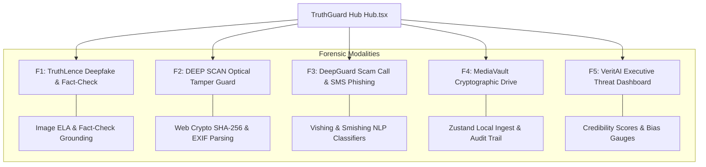
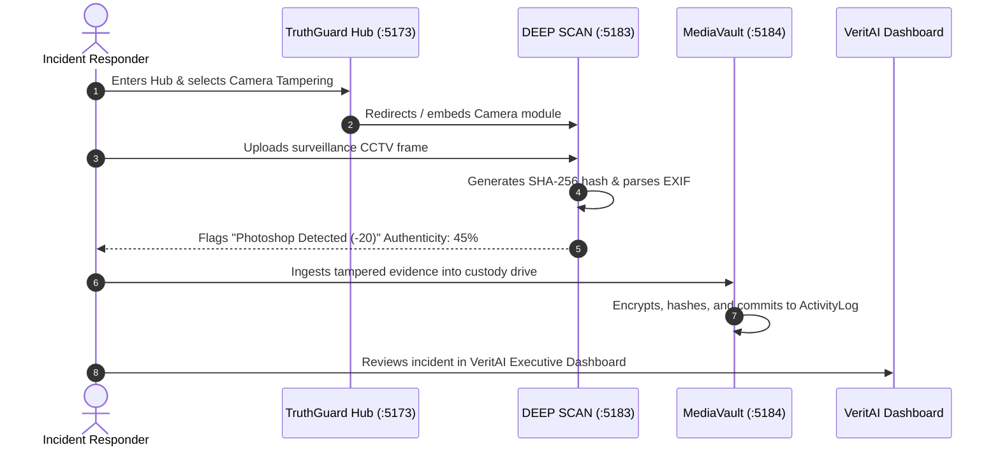

# Step 2: Feature Inventory & Forensic Subsystems

TruthGuard unifies 5 specialized cyber-defense and digital forensics modules under a cohesive architecture. This catalog summarizes each capability with implementation references, data models, and interview scripts.

---

## Complete Feature Matrix

| ID | Feature Name | Core Implementation Files | Modality & Engine | Key Architectural Role | Detailed Deep Dive |
|---|---|---|---|---|---|
| **F1** | TruthLence Deepfake & Fact-Check | [`truthlence/src/pages/Index.tsx`](file:///Users/avishjain/avishjain9-repos/33-codealchemist/truthlence/src/pages/Index.tsx) | Multi-modal text/image/URL + Edge AI | Detects synthetic diffusion artifacts, checks claims against PolitiFact and Snopes. | [F1 Deep Dive](file:///Users/avishjain/avishjain9-repos/33-codealchemist/docs/features/F1-truthlence-deepfake-image-forensics.md) |
| **F2** | DEEP SCAN Camera Tamper Guard | [`camara-temper/src/lib/fileAnalyzer.ts`](file:///Users/avishjain/avishjain9-repos/33-codealchemist/camara-temper/src/lib/fileAnalyzer.ts) | Web Crypto SHA-256 + `exifr` | Audits camera hardware EXIF, GPS location, and flags photo-editing software (Photoshop, GIMP). | [F2 Deep Dive](file:///Users/avishjain/avishjain9-repos/33-codealchemist/docs/features/F2-camera-tamper-optical-obstruction-guard.md) |
| **F3** | DeepGuard Scam Call & SMS Phishing | [`calldetection/src/pages/CallDetection.tsx`](file:///Users/avishjain/avishjain9-repos/33-codealchemist/calldetection-sms-contentdetection/src/pages/CallDetection.tsx) | Telecommunication NLP + Edge AI | Triages voice cloning scripts, bank impersonations, and urgency markers in calls & SMS. | [F3 Deep Dive](file:///Users/avishjain/avishjain9-repos/33-codealchemist/docs/features/F3-scam-call-sms-phishing-detector.md) |
| **F4** | MediaVault Cryptographic Drive | [`mediavault 2/src/lib/mediavault-store.ts`](file:///Users/avishjain/avishjain9-repos/33-codealchemist/mediavault%202/src/lib/mediavault-store.ts) | Zustand + LocalStorage + Web Crypto | Drag-and-drop evidence ingest pipeline, multi-stage encryption progress, and custody logs. | [F4 Deep Dive](file:///Users/avishjain/avishjain9-repos/33-codealchemist/docs/features/F4-mediavault-cryptographic-provenance.md) |
| **F5** | VeritAI Executive Threat Dashboard | [`mainpage/src/components/VeritAIApp.tsx`](file:///Users/avishjain/avishjain9-repos/33-codealchemist/mainpage/src/components/VeritAIApp.tsx) | React 18 + Supabase Auth + MBFC Tiers | 1,685-line dashboard calculating credibility scores (0–100), clickbait index, and dynamic port probing. | [F5 Deep Dive](file:///Users/avishjain/avishjain9-repos/33-codealchemist/docs/features/F5-unified-hub-threat-intelligence-dashboard.md) |

---

## Cross-Feature Data Flow & Dependencies

---

## Detailed Subsystem Summaries

### F1: TruthLence Deepfake & Content Verification
* **User Flow**: User drops a suspect image or inputs a URL into [`truthlence/src/pages/Index.tsx`](file:///Users/avishjain/avishjain9-repos/33-codealchemist/truthlence/src/pages/Index.tsx). The engine slices text up to 5,000 characters and dispatches a JSON body to `supabase.functions.invoke("analyze-media")`.
* **Output**: Renders an animated verdict badge (`authentic`, `suspicious`, `fake`), numerical confidence score, and fact-checking citations (PolitiFact, Snopes).
* **Say It Out Loud Script**: Available in [F1 Feature Deep Dive](file:///Users/avishjain/avishjain9-repos/33-codealchemist/docs/features/F1-truthlence-deepfake-image-forensics.md#5-say-it-out-loud-spoken-interview-script).

### F2: DEEP SCAN Camera Tamper & Lens Obstruction Engine
* **User Flow**: User drops a camera frame into [`camara-temper/src/pages/Index.tsx`](file:///Users/avishjain/avishjain9-repos/33-codealchemist/camara-temper/src/pages/Index.tsx). [`fileAnalyzer.ts`](file:///Users/avishjain/avishjain9-repos/33-codealchemist/camara-temper/src/lib/fileAnalyzer.ts) computes a Web Crypto SHA-256 digest, extracts EXIF/GPS tags using `exifr`, and audits editing software tags.
* **Output**: Radial SVG Authenticity Gauge (0–100), hardware specification grid (Make, Model, Lens, ISO, Shutter), and interactive GPS map.
* **Say It Out Loud Script**: Available in [F2 Feature Deep Dive](file:///Users/avishjain/avishjain9-repos/33-codealchemist/docs/features/F2-camera-tamper-optical-obstruction-guard.md#5-say-it-out-loud-spoken-interview-script).

### F3: DeepGuard Scam Call & SMS Phishing Classifier
* **User Flow**: Investigator pastes suspicious call dialogue or SMS messages into [`CallDetection.tsx`](file:///Users/avishjain/avishjain9-repos/33-codealchemist/calldetection-sms-contentdetection/src/pages/CallDetection.tsx) or [`SmsDetection.tsx`](file:///Users/avishjain/avishjain9-repos/33-codealchemist/calldetection-sms-contentdetection/src/pages/SmsDetection.tsx). Handlers invoke `analyze-content` on Supabase Edge.
* **Output**: Renders [`ResultCard.tsx`](file:///Users/avishjain/avishjain9-repos/33-codealchemist/calldetection-sms-contentdetection/src/components/ResultCard.tsx) with a color-coded threat badge, confidence bar, and bulleted risk indicators.
* **Say It Out Loud Script**: Available in [F3 Feature Deep Dive](file:///Users/avishjain/avishjain9-repos/33-codealchemist/docs/features/F3-scam-call-sms-phishing-detector.md#5-say-it-out-loud-spoken-interview-script).

### F4: MediaVault Cryptographic Storage & Custody Chain
* **User Flow**: Ingests files or web links into [`mediavault 2/src/pages/Index.tsx`](file:///Users/avishjain/avishjain9-repos/33-codealchemist/mediavault%202/src/pages/Index.tsx). Files stage in a Zustand queue; clicking upload visualizes a 3-step progress sequence (Reading -> Encrypting -> Storing) via [`ProgressModal.tsx`](file:///Users/avishjain/avishjain9-repos/33-codealchemist/mediavault%202/src/components/mediavault/ProgressModal.tsx).
* **Output**: Filterable asset library grid, detailed SHA-256 modal, and an immutable action log in [`ActivityLog.tsx`](file:///Users/avishjain/avishjain9-repos/33-codealchemist/mediavault%202/src/components/mediavault/ActivityLog.tsx).
* **Say It Out Loud Script**: Available in [F4 Feature Deep Dive](file:///Users/avishjain/avishjain9-repos/33-codealchemist/docs/features/F4-mediavault-cryptographic-provenance.md#5-say-it-out-loud-spoken-interview-script).

### F5: TruthGuard Unified Hub & VeritAI Executive Threat Dashboard
* **User Flow**: Landing page in [`Hub.tsx`](file:///Users/avishjain/avishjain9-repos/33-codealchemist/mainpage/src/pages/Hub.tsx) provides a 6-card navigation portal. Dynamic port scanner [`FeatureEmbed.tsx`](file:///Users/avishjain/avishjain9-repos/33-codealchemist/mainpage/src/pages/FeatureEmbed.tsx) issues `HEAD` requests to ports 5176–5200 to automatically discover active services. Navigating to `/dashboard` renders [`VeritAIApp.tsx`](file:///Users/avishjain/avishjain9-repos/33-codealchemist/mainpage/src/components/VeritAIApp.tsx).
* **Output**: Executive workstation with composite credibility gauges (0–100), MBFC source reliability ratings, claim dispute tables, and Supabase Auth session integration.
* **Say It Out Loud Script**: Available in [F5 Feature Deep Dive](file:///Users/avishjain/avishjain9-repos/33-codealchemist/docs/features/F5-unified-hub-threat-intelligence-dashboard.md#5-say-it-out-loud-spoken-interview-script).
