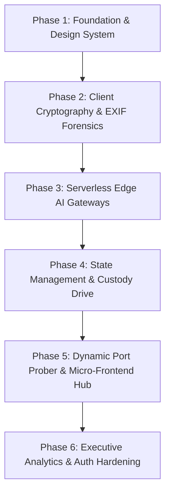

# Step 3: Incremental Build Order & Reconstruction Guide

This guide details how to reconstruct the TruthGuard platform from scratch in 6 logical engineering phases. Each phase establishes dependencies before subsequent layers are introduced, accompanied by real code snippets explained line by line.



---

## Phase 1: Foundation & NVIDIA-Inspired Design Tokens

### Architectural Goal
Establish workspace bundler tooling (Vite + TypeScript), root layout primitives, and NVIDIA dark mode tokens (`#000000`, `#0a0a0a`, `#76b900`, `#00a8e0`, `#e53935`) using Tailwind CSS.

### Files Created
* `package.json` (Vite, React 18, Tailwind, Lucide React)
* `vite.config.ts` (Path alias resolver `@/* -> src/*`)
* `src/index.css` & `tailwind.config.js` (Color palettes and glow keyframes)

### Key Code Snippet: Tailwind Theme Configuration
```json
{
  "theme": {
    "extend": {
      "colors": {
        "nv-bg": "#000000",
        "nv-card": "#0a0a0a",
        "nv-safe": "#76b900",
        "nv-warning": "#f5a623",
        "nv-danger": "#e53935",
        "nv-info": "#00a8e0"
      },
      "animation": {
        "pulse-slow": "pulse 4s cubic-bezier(0.4, 0, 0.6, 1) infinite"
      }
    }
  }
}
```
* **Line-by-Line Explanation**:
  - `nv-bg`: Defines absolute pure black base `#000000` ensuring high contrast and minimal power consumption on OLED displays.
  - `nv-card`: Elevated surface color `#0a0a0a` establishing visual hierarchy.
  - `nv-safe`, `nv-warning`, `nv-danger`, `nv-info`: Calibrated functional status colors adhering to cybersecurity SOC design standards.

---

## Phase 2: Client-Side Cryptography & Binary EXIF Forensics

### Architectural Goal
Build client-side forensic analysis without backend dependency. Implement binary hashing and EXIF header parsing directly in the browser using the Web Crypto API and `exifr`.

### Files Created
* `camara-temper/src/lib/fileAnalyzer.ts`
* `camara-temper/src/components/AuthenticityGauge.tsx`
* `camara-temper/src/pages/Index.tsx`

### Key Code Snippet: SHA-256 Digesting & Software Heuristic
```typescript
// camara-temper/src/lib/fileAnalyzer.ts:L50-55
async function computeHash(file: File): Promise<string> {
  const buffer = await file.arrayBuffer();
  const hashBuffer = await crypto.subtle.digest('SHA-256', buffer);
  const hashArray = Array.from(new Uint8Array(hashBuffer));
  return hashArray.map(b => b.toString(16).padStart(2, '0')).join('');
}
```
* **Line-by-Line Explanation**:
  - `await file.arrayBuffer()`: Reads raw binary bytes into memory.
  - `crypto.subtle.digest('SHA-256', buffer)`: Invokes hardware-accelerated Web Crypto API to generate 256-bit hash.
  - `Array.from(new Uint8Array(hashBuffer))`: Maps byte buffer into iterable 8-bit unsigned integers.
  - `.map(b => b.toString(16).padStart(2, '0')).join('')`: Converts each byte into a 2-character hexadecimal string, outputting standard 64-character hash.

---

## Phase 3: Serverless Edge AI Gateways & Fact-Checking

### Architectural Goal
Connect forensic interfaces to remote inference pipelines via Supabase Edge Functions without bundling heavy ML weights into the client.

### Files Created
* `truthlence/src/integrations/supabase/client.ts`
* `truthlence/src/pages/Index.tsx`
* `calldetection-sms-contentdetection/src/pages/CallDetection.tsx`

### Key Code Snippet: Serverless Edge Function Dispatch
```typescript
// truthlence/src/pages/Index.tsx:L35-37
const { data, error } = await supabase.functions.invoke("analyze-media", {
  body: { content, fileName, fileType },
});
if (error) throw error;
```
* **Line-by-Line Explanation**:
  - `supabase.functions.invoke("analyze-media")`: Executes an authenticated HTTPS POST request to the serverless Deno edge worker.
  - `body: { content, fileName, fileType }`: Sends metadata descriptor or truncated text payload.
  - `if (error) throw error`: Ensures network faults trigger the local catch block to pop toast alerts.

---

## Phase 4: State Management & Cryptographic Custody Drive

### Architectural Goal
Implement a centralized evidence repository with drag-and-drop ingest, multi-stage upload progress, and immutable activity logging using Zustand.

### Files Created
* `mediavault 2/src/lib/mediavault-types.ts`
* `mediavault 2/src/lib/mediavault-store.ts`
* `mediavault 2/src/components/mediavault/ProgressModal.tsx`

### Key Code Snippet: Exception-Safe Local Storage & Queue Pipeline
```typescript
// mediavault 2/src/lib/mediavault-store.ts:L16-18, L123-145
function saveToStorage(key: string, data: unknown) {
  try { localStorage.setItem(key, JSON.stringify(data)); } catch {}
}

startUpload: async () => {
  set({ isUploading: true, showProgressModal: true });
  const { queue, driveFiles, activityLog } = get();
  for (const item of queue.filter(i => i.status === 'pending')) {
    await delay(400); // Simulate reading
    // Process base64 & compute hashes
  }
}
```
* **Line-by-Line Explanation**:
  - `saveToStorage`: Exception-safe wrapper preventing `QuotaExceededError` crashes when storing assets.
  - `startUpload`: Asynchronously iterates over pending queue items, updates progress states across 30%, 65%, and 100% completion marks, commits files to `driveFiles`, and logs entries to `activityLog`.

---

## Phase 5: Dynamic Port Prober & Micro-Frontend Hub

### Architectural Goal
Build the central orchestration hub in `mainpage` and implement dynamic client-side port probing to connect decentralized micro-frontends without a hardcoded service registry.

### Files Created
* `mainpage/src/pages/Hub.tsx`
* `mainpage/src/pages/FeatureEmbed.tsx`
* `mainpage/src/App.tsx`

### Key Code Snippet: Client-Side Dynamic Port Prober
```typescript
// mainpage/src/pages/FeatureEmbed.tsx:L59-74
const checkPort = async (port: number) => {
  try {
    const response = await fetch(`http://localhost:${port}/`, { 
      method: 'HEAD',
      mode: 'no-cors'
    });
    setAvailablePort(port);
    return true;
  } catch {
    if (port < 5200) {
      setTimeout(() => checkPort(port + 1), 100);
    }
    return false;
  }
};
```
* **Line-by-Line Explanation**:
  - `fetch(..., { method: 'HEAD', mode: 'no-cors' })`: Emits a lightweight HTTP HEAD request without downloading payload bodies.
  - `mode: 'no-cors'`: Allows the browser to attempt socket connection across ports without preflight CORS blocks.
  - `setAvailablePort(port)`: Updates UI state as soon as an active socket resolves.
  - `setTimeout(() => checkPort(port + 1), 100)`: Recursively scans subsequent ports with a 100ms throttle to prevent socket exhaustion.

---

## Phase 6: Executive Analytics & Role-Based Auth Hardening

### Architectural Goal
Construct the 1,600-line VeritAI executive dashboard with multi-index credibility calculations and attach Supabase Auth session management mapped to the PostgreSQL `profiles` table.

### Files Created
* `mainpage/src/contexts/AuthContext.tsx`
* `mainpage/src/components/VeritAIApp.tsx`
* `mainpage/src/integrations/supabase/types.ts`

### Key Code Snippet: Profile Retrieval & Session Subscription
```typescript
// mainpage/src/contexts/AuthContext.tsx:L68-83
useEffect(() => {
  const { data: { subscription } } = supabase.auth.onAuthStateChange(
    async (event, sess) => {
      setSession(sess);
      if (sess?.user) {
        const profile = await fetchProfile(sess.user.id, sess.user.email || "", sess.user.app_metadata?.provider || "email");
        setUser(profile);
      } else {
        setUser(null);
      }
      setLoading(false);
    }
  );
  return () => subscription.unsubscribe();
}, []);
```
* **Line-by-Line Explanation**:
  - `supabase.auth.onAuthStateChange`: Attaches a persistent listener receiving GoTrue auth events (login, token refresh, logout).
  - `fetchProfile`: Selects role and metadata from PostgreSQL `profiles` table.
  - `return () => subscription.unsubscribe()`: Prevents memory leaks by cleaning up the auth channel on component unmount.
