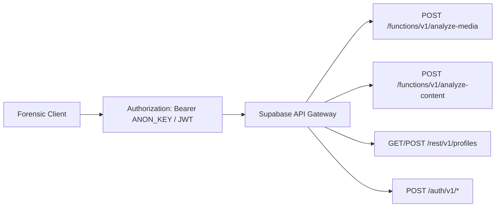
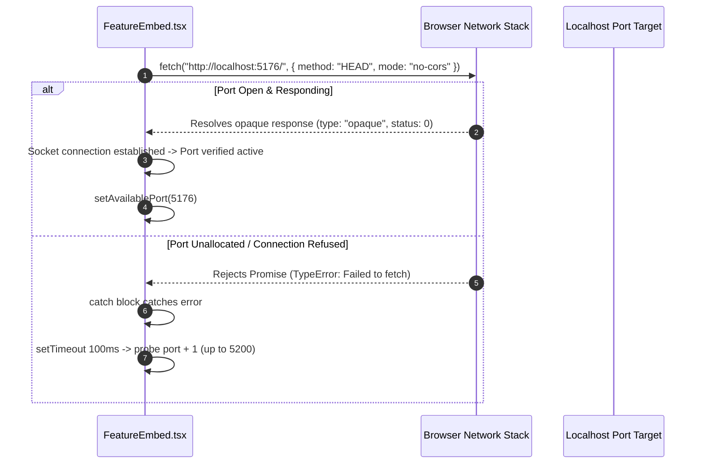

# Step 4: Complete API & Protocol Reference

This reference documents all backend endpoints, serverless Edge Functions, authentication contracts, and client-side inter-module protocols across TruthGuard.



---

## 1. Edge Function: `analyze-media`

* **Method & Path**: `POST https://<project-ref>.supabase.co/functions/v1/analyze-media`
* **Invocation Method in Code**: `supabase.functions.invoke("analyze-media", { body: ... })` ([`truthlence/src/pages/Index.tsx:L35`](file:///Users/avishjain/avishjain9-repos/33-codealchemist/truthlence/src/pages/Index.tsx#L35))
* **Authentication**: Optional / Anonymous public key via `Authorization: Bearer <VITE_SUPABASE_PUBLISHABLE_KEY>`.
* **Request Headers**:
  - `Content-Type: application/json`
  - `apikey: <VITE_SUPABASE_PUBLISHABLE_KEY>`
* **Request Body Payload**:
  ```json
  {
    "content": "Presidential executive announcement claiming emergency bank closure...",
    "fileName": "statement_press_release.pdf",
    "fileType": "application/pdf"
  }
  ```
* **Validation Rules**:
  - `content`: Required string. Sliced to 5,000 characters by client if exceeding limit.
  - `fileName`: Required string for forensic provenance.
  - `fileType`: Valid MIME type string (`text/plain`, `application/pdf`, `image/*`).
* **Success Response (200 OK)**:
  ```json
  {
    "verdict": "fake",
    "confidence": 92.5,
    "summary": "High likelihood of generative AI manipulation and fabricated quotes.",
    "details": [
      "Linguistic anomaly: Unnatural syntax distributions matching synthetic text generators.",
      "Compression mismatch detected across color-frequency bands.",
      "Claim contradicts verified treasury bulletins."
    ],
    "factCheckSources": [
      {
        "source": "PolitiFact",
        "rating": "PANTS ON FIRE",
        "url": "https://www.politifact.com/factchecks/..."
      },
      {
        "source": "Reuters Fact Check",
        "rating": "FALSE",
        "url": "https://www.reuters.com/fact-check/..."
      }
    ]
  }
  ```
* **Error Responses**:
  - `400 Bad Request`: `{ "error": "Missing required field: content" }`
  - `401 Unauthorized`: `{ "message": "Invalid API key" }`
  - `504 Gateway Timeout`: Function execution exceeded standard 15s execution threshold.
* **Middleware Chain**: TLS Termination -> Supabase Kong API Gateway -> Deno V8 Edge Worker -> Handler Logic.

---

## 2. Edge Function: `analyze-content`

* **Method & Path**: `POST https://<project-ref>.supabase.co/functions/v1/analyze-content`
* **Invocation Method in Code**: `supabase.functions.invoke("analyze-content", { body: ... })` ([`calldetection/src/pages/CallDetection.tsx:L23`](file:///Users/avishjain/avishjain9-repos/33-codealchemist/calldetection-sms-contentdetection/src/pages/CallDetection.tsx#L23))
* **Authentication**: Anonymous public key or authenticated JWT.
* **Request Body Payload**:
  ```json
  {
    "type": "call",
    "content": "Caller: Hello, this is the internal fraud department. We have placed a hold on your checking account due to an unauthorized $5,000 wire. I need you to confirm your Social Security Number right now."
  }
  ```
* **Validation Rules**:
  - `type`: Must be one of `"call"`, `"sms"`, or `"content"`.
  - `content`: Non-empty trimmed string.
* **Success Response (200 OK)**:
  ```json
  {
    "verdict": "fake",
    "confidence": 96.0,
    "analysis": "Severe social engineering markers detected. The transcript displays artificial urgency and direct solicitation of high-risk credentials (SSN).",
    "indicators": [
      "Artificial Urgency / Coercive Psychological Pressure",
      "Direct Solicitation of Social Security Number (SSN)",
      "Unverified Caller Claiming High-Risk Financial Action",
      "Syntax Matches Voice Cloning Script Templates"
    ]
  }
  ```
* **Error Responses**:
  - `422 Unprocessable Entity`: Invalid modality type specified.
  - `500 Internal Server Error`: Parsing failure in NLP engine.

---

## 3. Database REST API: `profiles`

* **Method & Path**: `GET https://<project-ref>.supabase.co/rest/v1/profiles?user_id=eq.<UUID>&select=*`
* **Invocation Method in Code**: `supabase.from("profiles").select("*").eq("user_id", userId).single()` ([`mainpage/src/contexts/AuthContext.tsx:L38-42`](file:///Users/avishjain/avishjain9-repos/33-codealchemist/mainpage/src/contexts/AuthContext.tsx#L38-L42))
* **Authentication**: Required (`Authorization: Bearer <USER_JWT>`).
* **Row Level Security (RLS)**: Enforces that `auth.uid() = user_id`. Users can only select or update their own profile.
* **Success Response (200 OK)**:
  ```json
  {
    "id": "7b3d168e-9c01-4f21-ac54-33cd828868e9",
    "user_id": "4a2b918f-1234-5678-abcd-ef0123456789",
    "display_name": "Sarah Connor",
    "avatar_url": null,
    "role": "Analyst",
    "provider": "email",
    "created_at": "2026-03-15T08:30:00Z",
    "updated_at": "2026-03-15T08:30:00Z"
  }
  ```

---

## 4. Authentication Endpoints (Supabase GoTrue)

| Path | Method | Payload | Success Response | Purpose |
|---|---|---|---|---|
| `/auth/v1/token?grant_type=password` | `POST` | `{ email, password }` | `{ access_token, refresh_token, user }` | Authenticates email/password credentials and issues JWT. |
| `/auth/v1/signup` | `POST` | `{ email, password, data: { full_name } }` | `{ id, email, confirmation_sent_at }` | Registers user record and triggers profile row initialization. |
| `/auth/v1/logout` | `POST` | None (Bearer Token) | `204 No Content` | Invalidates active session. |

---

## 5. Client Cross-Port Inter-Module Discovery Protocol

TruthGuard utilizes an asynchronous client-side port discovery protocol to dynamically bridge the hub (`:5173`) to decentralized micro-frontends.



* **Protocol Details**:
  - **Method**: `HEAD` prevents downloading redundant assets (HTML/JS bundles), minimizing local CPU and network overhead.
  - **Mode**: `no-cors` allows the browser to issue requests across differing origins (e.g., port 5173 querying port 5183) without failing preflight CORS checks. While the response body cannot be inspected by JavaScript, the *promise resolution* itself confirms an active HTTP listener on that port.
  - **Scan Range**: Scans from base port `5176` up to `5200` with a 100ms throttle.
