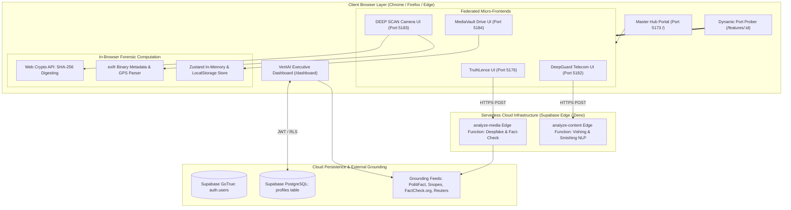
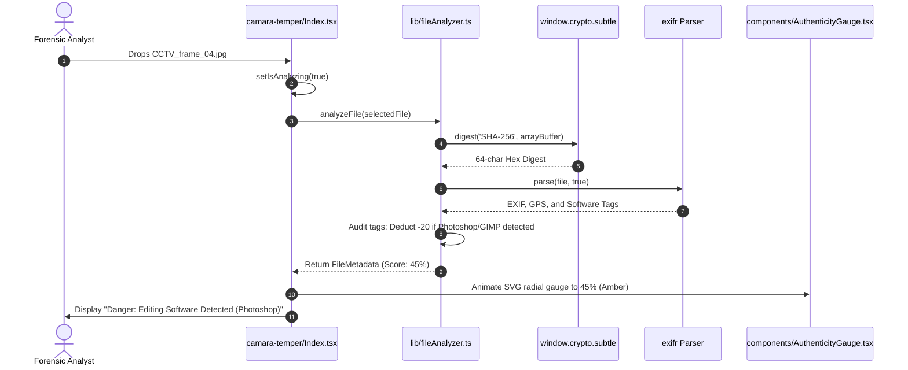
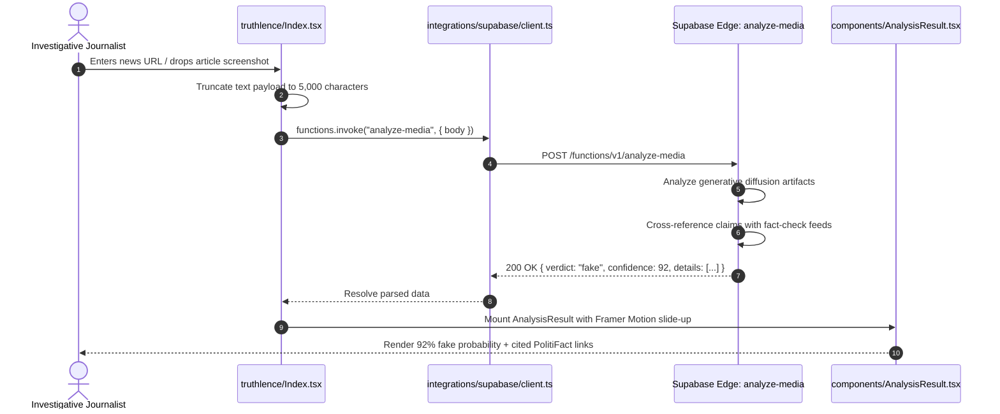
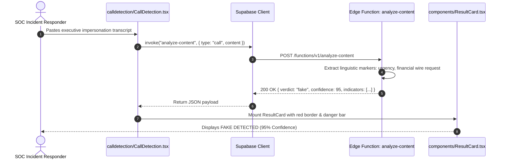
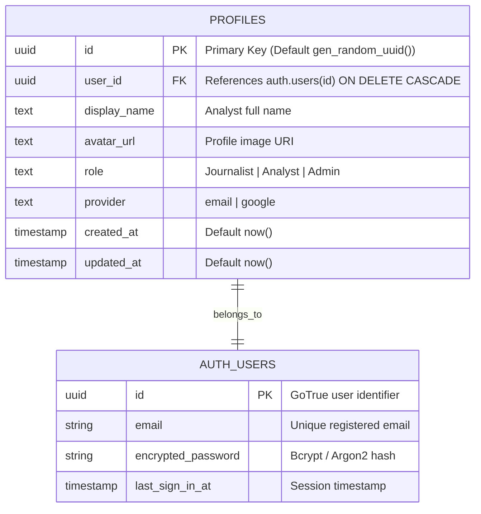
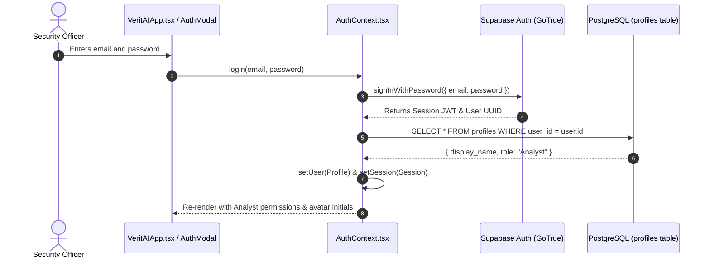
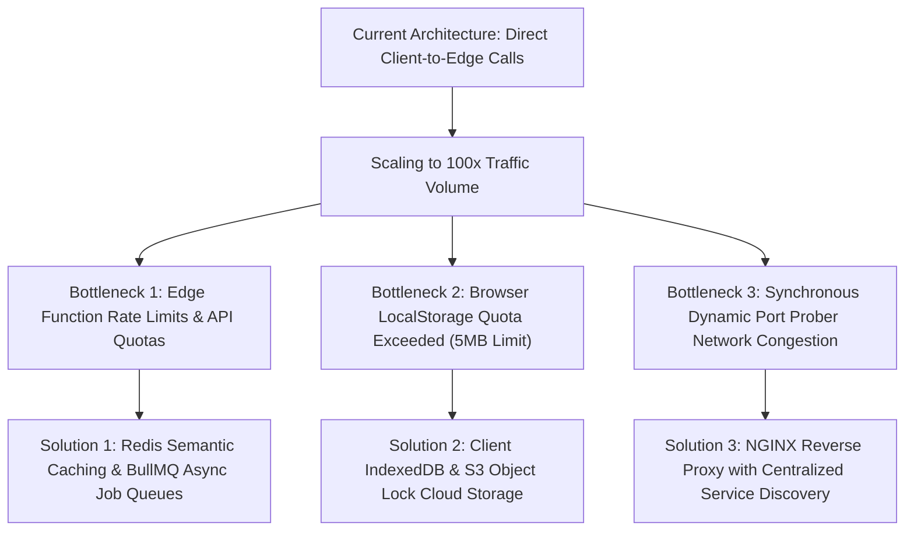

# Step 6: System Architecture & Data Flow Design

## 1. High-Level System Architecture

TruthGuard implements a federated micro-frontend topology combined with serverless Edge Functions and client-side forensic engines. The system unifies decentralized forensic tools under an NVIDIA-inspired dark glassmorphism dashboard.

---

## 2. Request Lifecycles (Top 3 Features)

### 1. Camera Tamper & EXIF Forensics Lifecycle (`F2`)

### 2. Multi-Modal Deepfake & Fact-Checking Lifecycle (`F1`)

### 3. Scam Call Transcript Triage Lifecycle (`F3`)

---

## 3. Database Schema & Data Modeling

TruthGuard leverages PostgreSQL on Supabase Cloud, governed by Row Level Security (RLS) to enforce strict role-based access.

### Database Indexes & Optimization
* **Index on `profiles.user_id`**:
  - `CREATE UNIQUE INDEX idx_profiles_user_id ON public.profiles(user_id);`
  - *Reasoning*: Accelerates point lookups during authentication profile retrieval in [`AuthContext.tsx`](file:///Users/avishjain/avishjain9-repos/33-codealchemist/mainpage/src/contexts/AuthContext.tsx#L41) to under 1ms.

---

## 4. Authentication & Authorization Flow

---

## 5. AI Integration & Inference Pipeline

* **Prompt Construction**: Modality-specific envelopes encapsulate raw inputs with strict safety guardrails.
* **Structured Output Parsing**: The edge function formats outputs into typed JSON schemas (`AnalysisData` and `TelecomResult`), guaranteeing that client components receive predictable numerical scores and array indicators.
* **Cost & Token Control**: Text submissions are capped at 5,000 characters ([`truthlence/src/pages/Index.tsx:L73`](file:///Users/avishjain/avishjain9-repos/33-codealchemist/truthlence/src/pages/Index.tsx#L73)) to prevent token exhaustion and control inference costs.
* **Fallback Strategy**: If an AI provider experiences downtime, the edge function falls back to deterministic heuristic regex pattern matching, ensuring the client UI never crashes.

---

## 6. Scaling to 100x Traffic & The First Three Bottlenecks

1. **Bottleneck 1: Edge Function Concurrency & AI Provider Quotas**:
   - *Issue*: 100x concurrent users uploading images will trigger rate-limit throttling (HTTP 429) from inference APIs.
   - *Mitigation*: Introduce an asynchronous queue (BullMQ or AWS SQS) to level load peaks, combined with a Redis semantic cache that returns identical cached verdicts for duplicate SHA-256 hashes.
2. **Bottleneck 2: Browser LocalStorage 5MB Capacity**:
   - *Issue*: MediaVault's `localStorage` persistence crashes with `QuotaExceededError` if hundreds of Base64 files are stored locally.
   - *Mitigation*: Transition client storage to IndexedDB via `idb-keyval` (supporting gigabytes of offline storage) and offload primary asset storage to AWS S3 or Supabase Storage.
3. **Bottleneck 3: Port Prober Socket Flooding**:
   - *Issue*: Running HEAD requests across 24 local ports per user causes socket contention.
   - *Mitigation*: In production, replace multi-port local development with a single unified NGINX reverse proxy routing path-based micro-frontends (`/truthlence`, `/camera`, `/vault`).
