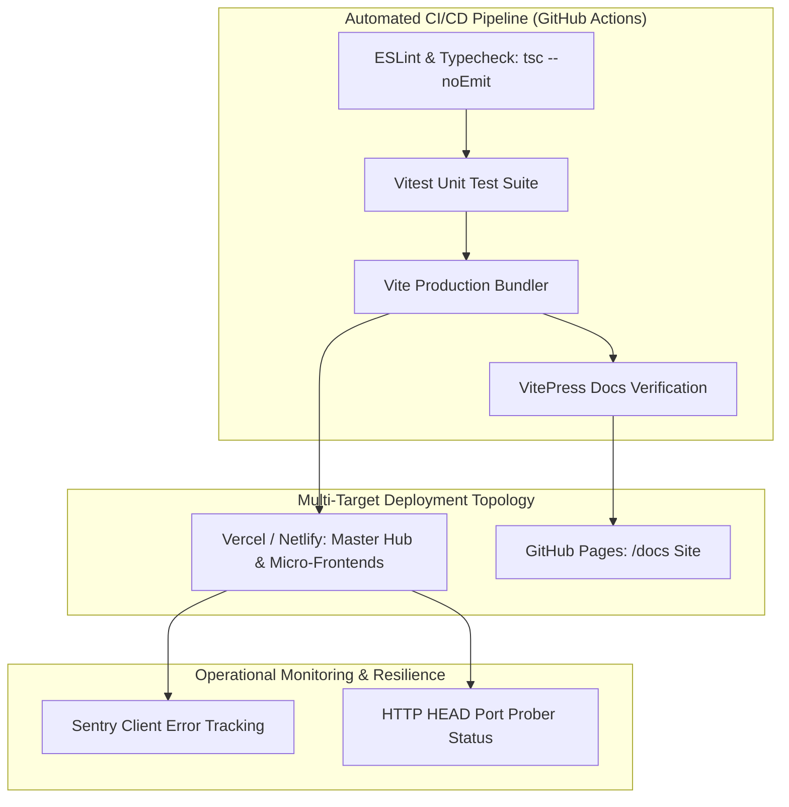

# Step 9: Engineering Quality, DevOps & Operational Resilience

This evaluation audits TruthGuard's testing infrastructure, CI/CD automation, build pipelines, operational monitoring, and technical debt.



---

## 1. Testing Infrastructure & Coverage Audit

### Existing Test Setup
* **Runner**: Vitest configured across all subprojects with JSDOM environment.
* **Setup Files**: `src/test/setup.ts` in each module imports `@testing-library/jest-dom` and mocks browser APIs:
  ```typescript
  // camara-temper/src/test/setup.ts:L3-16
  Object.defineProperty(window, "matchMedia", {
    writable: true,
    value: (query: string) => ({
      matches: false,
      media: query,
      onchange: null,
      addListener: () => {},
      removeListener: () => {},
      addEventListener: () => {},
      removeEventListener: () => {},
      dispatchEvent: () => {},
    }),
  });
  ```
* **Existing Unit Tests**: Smoke tests (`src/test/example.test.ts`) assert `expect(true).toBe(true)` to validate test runner execution.

### Missing Test Coverage & Recommendations
1. **File Analyzer Unit Tests (`camara-temper/src/lib/fileAnalyzer.ts`)**:
   - *Missing*: Unit tests validating that known tampered EXIF files (e.g., Photoshop software tag) correctly deduct 20 points from the authenticity score.
   - *Fix*: Create mock `File` objects with binary EXIF buffers and assert `result.authenticityScore <= 55`.
2. **Dynamic Port Prober Tests (`mainpage/src/pages/FeatureEmbed.tsx`)**:
   - *Missing*: Mocking `fetch` HEAD responses to test automatic port increments from 5176 to 5200.
3. **End-to-End (E2E) Workflows**:
   - *Recommendation*: Add Playwright or Cypress tests to simulate the analyst journey: landing on Hub -> navigating to TruthLence -> dropping an image -> verifying that the verdict card renders.

---

## 2. CI/CD & Deployment Strategy

### Recommended GitHub Actions Workflow (`.github/workflows/ci.yml`)
```yaml
name: TruthGuard CI/CD Pipeline

on:
  push:
    branches: [ main ]
  pull_request:
    branches: [ main ]

jobs:
  validate-and-build:
    runs-on: ubuntu-latest
    steps:
      - uses: actions/checkout@v4
      
      - name: Setup Node.js 20
        uses: actions/setup-node@v4
        with:
          node-version: 20
          cache: 'npm'
          
      - name: Install Dependencies
        run: npm ci
        
      - name: Typecheck TypeScript
        run: npx tsc --noEmit
        
      - name: Run Vitest Unit Tests
        run: npm run test:run
        
      - name: Build VitePress Documentation
        run: npm run docs:build
        
      - name: Build Production Frontend Bundles
        run: npm run build
```

---

## 3. Performance Bottlenecks & Race Conditions

1. **Client Memory Exhaustion with Multi-Gigabyte Media**:
   - *Issue*: Reading large video files via `file.arrayBuffer()` ([`fileAnalyzer.ts:L51`](file:///Users/avishjain/avishjain9-repos/33-codealchemist/camara-temper/src/lib/fileAnalyzer.ts#L51)) loads the entire file into JavaScript heap memory, risking browser crashes on low-RAM devices.
   - *Solution*: Stream the file in 2MB chunks using `ReadableStream` and update SHA-256 state incrementally via Web Crypto streams or a Web Worker.
2. **LocalStorage Quota Bomb in MediaVault**:
   - *Issue*: `mediavault 2` stores Base64 encoded files inside `localStorage` (`STORAGE_KEY_FILES`), which is limited to 5MB by browser security policies.
   - *Mitigation*: While `saveToStorage` catches the exception safely, files beyond 5MB are only stored in memory. Migrating to `IndexedDB` provides gigabytes of persistent browser storage.
3. **Async Race Conditions in Port Prober**:
   - *Issue*: Rapid component unmounting while `checkPort` is in a `setTimeout` loop ([`FeatureEmbed.tsx:L70`](file:///Users/avishjain/avishjain9-repos/33-codealchemist/mainpage/src/pages/FeatureEmbed.tsx#L70)) could trigger state updates on unmounted components.
   - *Solution*: Attach an `AbortController` signal to the `fetch` call and cancel the timeout during `useEffect` cleanup.

---

## 4. Technical Debt Catalog

| Debt Item | Location | Severity | Architectural Impact | Remediation Plan |
|---|---|---|---|---|
| **Hardcoded Demo Records** | `mainpage/src/components/VeritAIApp.tsx:L12-72` | Low | Demonstrates capability effectively, but live scanning uses simulated delay instead of dynamic DOM scraping. | Connect URL scanner to a real backend readability parser (e.g., Mozilla Readability). |
| **LocalStorage File Custody** | `mediavault 2/src/lib/mediavault-store.ts:L16` | Moderate | 5MB storage limit restricts MediaVault to small images and text files. | Refactor store to use `idb-keyval` or connect directly to Supabase Storage buckets. |
| **Simulated Progress Timer** | `mediavault 2/src/lib/mediavault-store.ts:L133-145` | Low | Upload stages (Reading, Encrypting, Storing) use `delay(400)` timers instead of real encryption callbacks. | Replace simulated delay with real Web Crypto AES-GCM encryption streams. |
| **Unprotected Extension ZIP** | `truthlence/src/pages/Index.tsx:L100` | Low | Extension downloaded directly from static asset folder without version tracking. | Host extension on Chrome Web Store or publish signed CRX bundles. |
