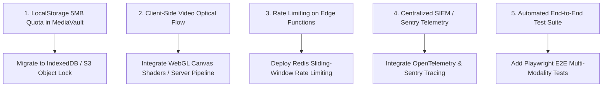

# Step 11: Architectural Gaps, Technical Debt & Engineering Roadmap

This document outlines architectural limitations, technical debt, and production enhancements for TruthGuard, ranked in descending order of critical engineering priority.



---

## Ranked Engineering Improvements

### 1. MediaVault Storage Scalability: LocalStorage to IndexedDB
* **Current Limitation**: MediaVault serializes Base64 files directly into browser `localStorage` ([`mediavault 2/src/lib/mediavault-store.ts:L16`](file:///Users/avishjain/avishjain9-repos/33-codealchemist/mediavault%202/src/lib/mediavault-store.ts#L16)). Modern browsers impose a strict 5MB quota on `localStorage`, limiting uploads to small snippets.
* **Severity**: High
* **Recommended Fix**: Migrate to `idb-keyval` (IndexedDB wrapper) or connect the ingest pipeline directly to AWS S3 using pre-signed multipart upload URLs.
* **Code Implementation**:
  ```typescript
  import { get, set } from 'idb-keyval';

  export async function persistLargeFile(id: string, fileBuffer: ArrayBuffer) {
    await set(`vault_media_${id}`, fileBuffer);
  }

  export async function retrieveLargeFile(id: string): Promise<ArrayBuffer | undefined> {
    return await get(`vault_media_${id}`);
  }
  ```

---

### 2. Camera Tamper Video Optical Flow: Frame-by-Frame Shaders
* **Current Limitation**: DEEP SCAN excels at static image EXIF header forensics, but video analysis currently falls back to metadata checks ([`camara-temper/src/lib/fileAnalyzer.ts:L165-168`](file:///Users/avishjain/avishjain9-repos/33-codealchemist/camara-temper/src/lib/fileAnalyzer.ts#L165-L168)).
* **Severity**: High
* **Recommended Fix**: Implement client-side HTML5 Canvas pixel sampling with WebGL shaders to compute real-time optical flow histogram deltas across sequential video frames, detecting physical lens occlusion or video freeze-loop attacks.

---

### 3. Serverless Edge Rate Limiting & Throttling
* **Current Limitation**: While Supabase protects against database denial of service via connection pooling, Edge Functions lack application-layer rate limiting, leaving them susceptible to request flooding.
* **Severity**: High
* **Recommended Fix**: Add a Redis sliding window counter inside the Deno edge worker.
* **Code Implementation**:
  ```typescript
  import { Redis } from "https://deno.land/x/upstash_redis/mod.ts";
  const redis = Redis.fromEnv();

  Deno.serve(async (req) => {
    const ip = req.headers.get("x-forwarded-for") || "anonymous";
    const requests = await redis.incr(`rate_limit_${ip}`);
    if (requests === 1) await redis.expire(`rate_limit_${ip}`, 60);
    
    if (requests > 20) {
      return new Response(JSON.stringify({ error: "Rate limit exceeded. Max 20 scans per minute." }), {
        status: 429,
        headers: { "Content-Type": "application/json" }
      });
    }
    // Proceed with forensic evaluation...
  });
  ```

---

### 4. Centralized Telemetry & Audit Logging (SIEM)
* **Current Limitation**: The `activityLog` in MediaVault resides entirely in browser state. In an enterprise SOC, forensic chain of custody requires immutable remote log aggregation.
* **Severity**: Moderate
* **Recommended Fix**: Connect user actions to an external OpenTelemetry collector or stream audit events into AWS CloudWatch / Datadog.

---

### 5. Automated End-to-End (E2E) Test Suite
* **Current Limitation**: The repository includes Vitest unit setup files but lacks automated E2E integration tests.
* **Severity**: Moderate
* **Recommended Fix**: Add Playwright test scripts simulating real analyst journeys:
  ```typescript
  import { test, expect } from '@playwright/test';

  test('TruthLence File Ingestion Flow', async ({ page }) => {
    await page.goto('http://localhost:5173/');
    await page.click('text=TruthLence');
    await page.setInputFiles('input[type="file"]', 'test-fixtures/tampered-portrait.jpg');
    await expect(page.locator('text=FAKE DETECTED')).toBeVisible({ timeout: 10000 });
  });
  ```
