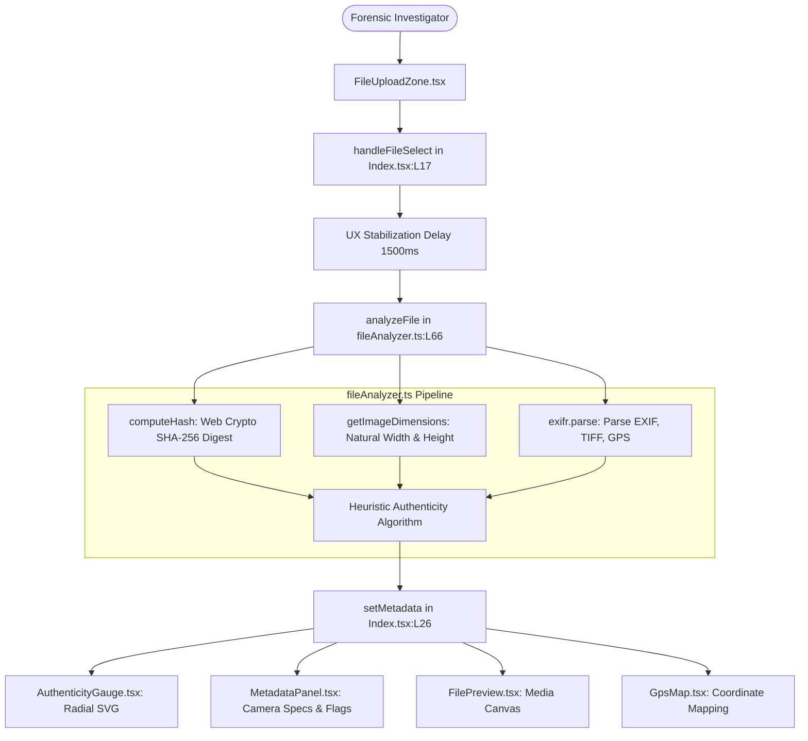
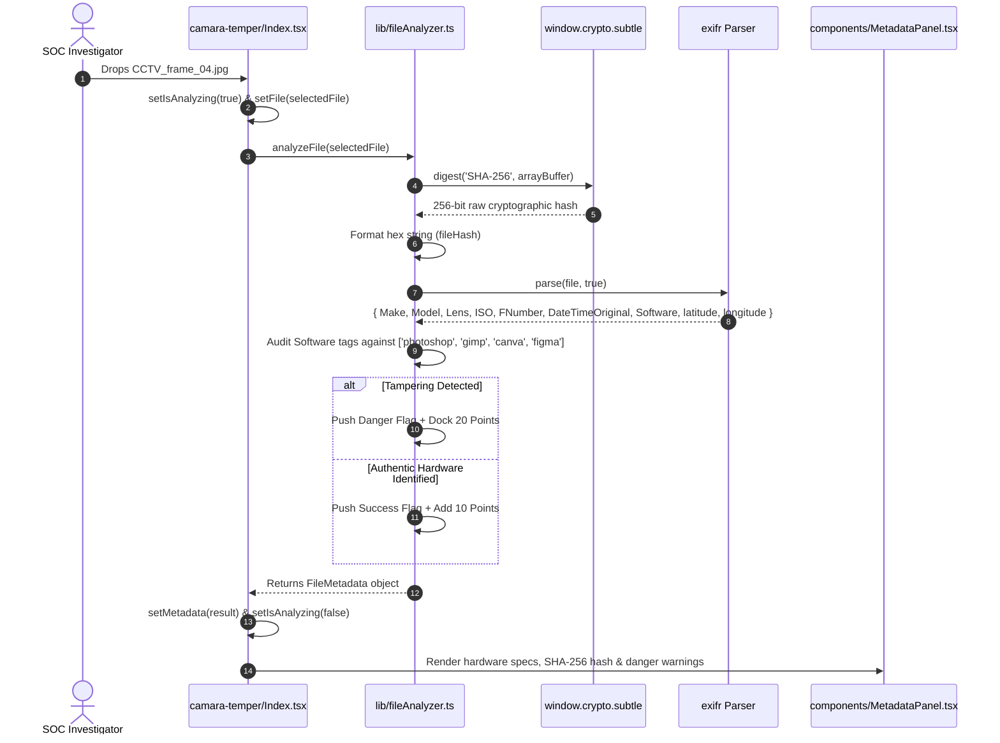
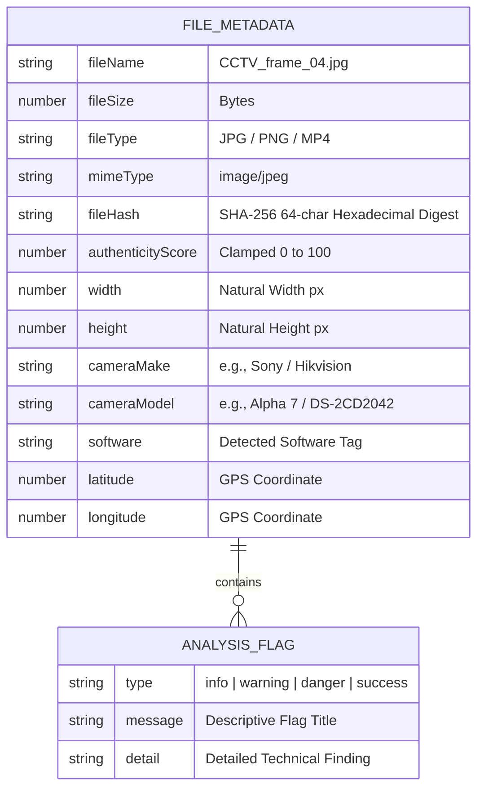
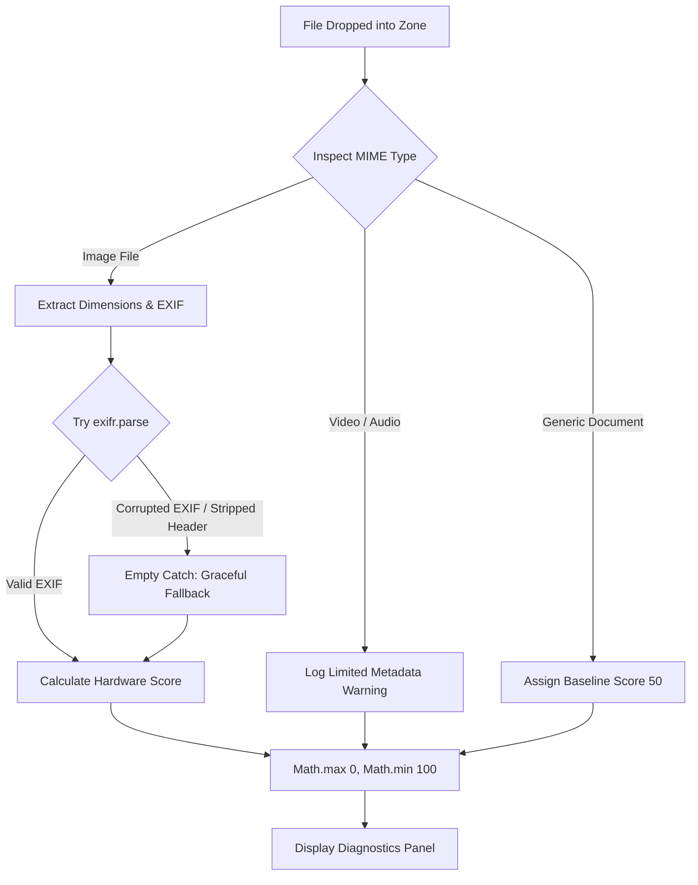

# F2: DEEP SCAN Camera Tamper & Lens Obstruction Engine

## 1. Feature Identity & Behavioral Overview
* **Feature Name**: DEEP SCAN Optical Camera Tamper & Forensic Metadata Analyzer
* **Identifier**: `F2`
* **One-Line Description**: Inspects raw surveillance frames and photographic evidence for physical camera lens tampering, software modification signatures, and stripped metadata.
* **User-Facing Behavior**: When accessing the DEEP SCAN module (`http://localhost:5183`), the user drops an image, video, audio, or data file into [`FileUploadZone.tsx`](file:///Users/avishjain/avishjain9-repos/33-codealchemist/camara-temper/src/components/FileUploadZone.tsx). The system transitions to an analyzing state, parses file bytes, and renders a forensic command dashboard featuring an SVG [`AuthenticityGauge.tsx`](file:///Users/avishjain/avishjain9-repos/33-codealchemist/camara-temper/src/components/AuthenticityGauge.tsx) (0–100 score), a detailed [`MetadataPanel.tsx`](file:///Users/avishjain/avishjain9-repos/33-codealchemist/camara-temper/src/components/MetadataPanel.tsx) listing camera hardware specs (Make, Model, Lens, Focal Length, Aperture, Shutter Speed, ISO, Flash, Color Space), a cryptographic SHA-256 fingerprint, and an embedded [`GpsMap.tsx`](file:///Users/avishjain/avishjain9-repos/33-codealchemist/camara-temper/src/components/GpsMap.tsx) if coordinates exist.

---

## 2. Architecture & Flow Diagrams

### Component Interaction Flowchart

### Request & Processing Sequence Diagram

### Forensic Data Entity Relationship

### Failure & Graceful Degradation Diagram

---

## 3. Function & Implementation Inventory

| Function Name | Location | Parameters | Return Type | Purpose & Implementation Details |
|---|---|---|---|---|
| `analyzeFile` | [`camara-temper/src/lib/fileAnalyzer.ts:L66-179`](file:///Users/avishjain/avishjain9-repos/33-codealchemist/camara-temper/src/lib/fileAnalyzer.ts#L66-L179) | `file: File` | `Promise<FileMetadata>` | Main forensic orchestrator. Computes SHA-256 digest, extracts image dimensions, parses EXIF/GPS, audits software manipulation tags, and computes 0–100 authenticity score. |
| `computeHash` | [`camara-temper/src/lib/fileAnalyzer.ts:L50-55`](file:///Users/avishjain/avishjain9-repos/33-codealchemist/camara-temper/src/lib/fileAnalyzer.ts#L50-L55) | `file: File` | `Promise<string>` | Invokes browser Web Crypto API `crypto.subtle.digest('SHA-256', buffer)` and maps resulting bytes to hexadecimal notation. |
| `getImageDimensions` | [`camara-temper/src/lib/fileAnalyzer.ts:L57-64`](file:///Users/avishjain/avishjain9-repos/33-codealchemist/camara-temper/src/lib/fileAnalyzer.ts#L57-L64) | `file: File` | `Promise<{width, height}>` | Instantiates a native `new Image()`, creates an object URL, and resolves `naturalWidth` and `naturalHeight` upon load. |
| `handleFileSelect` | [`camara-temper/src/pages/Index.tsx:L17-28`](file:///Users/avishjain/avishjain9-repos/33-codealchemist/camara-temper/src/pages/Index.tsx#L17-L28) | `selectedFile: File` | `Promise<void>` | Sets loading state, executes a 1,500ms stabilization delay for visual telemetry, awaits `analyzeFile`, and sets metadata state. |
| `handleReset` | [`camara-temper/src/pages/Index.tsx:L30-34`](file:///Users/avishjain/avishjain9-repos/33-codealchemist/camara-temper/src/pages/Index.tsx#L30-L34) | None | `void` | Resets file, metadata, and loading states back to initial idle view. |

---

## 4. Engineering Quality, Edge Cases & Security

* **Heuristic Scoring Model**:
  - Baseline score: `75`.
  - Camera make & model confirmed: `+10` points (`success` flag).
  - Missing camera data: `-10` points (`warning` flag - possible synthetic generation).
  - Original capture date present: `+5` points; missing: `-5` points.
  - GPS coordinates present: `+5` points (`info` flag).
  - Software tampering detected (`photoshop`, `gimp`, `lightroom`, `snapseed`, `canva`, `figma`): `-20` points (`danger` flag).
  - Clamping function: `Math.max(0, Math.min(100, authenticityScore))` ensures invariant bounded outputs.
* **Edge Cases & Graceful Degradation**:
  - Non-image files (videos, audio, PDFs) do not crash the binary parser. Isolated `try-catch` blocks absorb parse failures and assign informative fallback flags (`"Limited metadata extraction"`).
* **Security & Memory Safety**:
  - All hash computations execute within the secure browser sandbox via `window.crypto.subtle`.
  - Object URLs created during dimension checking are transiently handled to avoid DOM memory leaks.

---

## 5. Say It Out Loud (Spoken Interview Script)

> "In DEEP SCAN, located in `camara-temper/src/lib/fileAnalyzer.ts`, I built our client-side camera tamper and forensic metadata analyzer. In video surveillance and digital evidence, attackers frequently tamper with cameras using physical occlusions like spray paint, or manipulate digital frames in editors like Photoshop before submission.
> 
> When an investigator drops a suspect media file, `handleFileSelect` initiates analysis. First, I use the browser's native Web Crypto API to calculate a cryptographic SHA-256 hash directly from the file buffer, creating an immutable tamper-evident fingerprint. Next, I parse EXIF and TIFF headers using `exifr` to extract low-level hardware attributes like camera make, lens model, aperture, ISO, and GPS coordinates.
> 
> My heuristic algorithm starts at a baseline authenticity score of 75. If camera make and model match genuine hardware, I add 10 points. If original capture dates are stripped, I dock 5 points. Crucially, I inspect the software tags against known raster editors like Photoshop, GIMP, Canva, and Figma. If an editing signature is detected, I dock 20 points and raise a high-severity danger alert.
> 
> I chose native client-side Web Crypto and `exifr` rather than uploading images to a remote server. This allows analysis to complete in milliseconds, preserves evidence chain of custody, and guarantees that sensitive surveillance footage never leaves the investigator's machine.
> 
> If a file has corrupted EXIF headers, the parsing routine catches the error silently, falls back to raw binary metrics, and flags that metadata was stripped.
> 
> One current limitation is that video optical flow analysis is limited in the browser. If I rebuilt this for an enterprise SOC, I would integrate WebGL canvas shaders to analyze frame-by-frame histogram deltas in real time."
