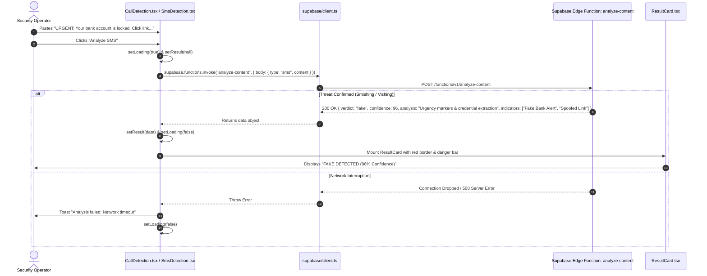
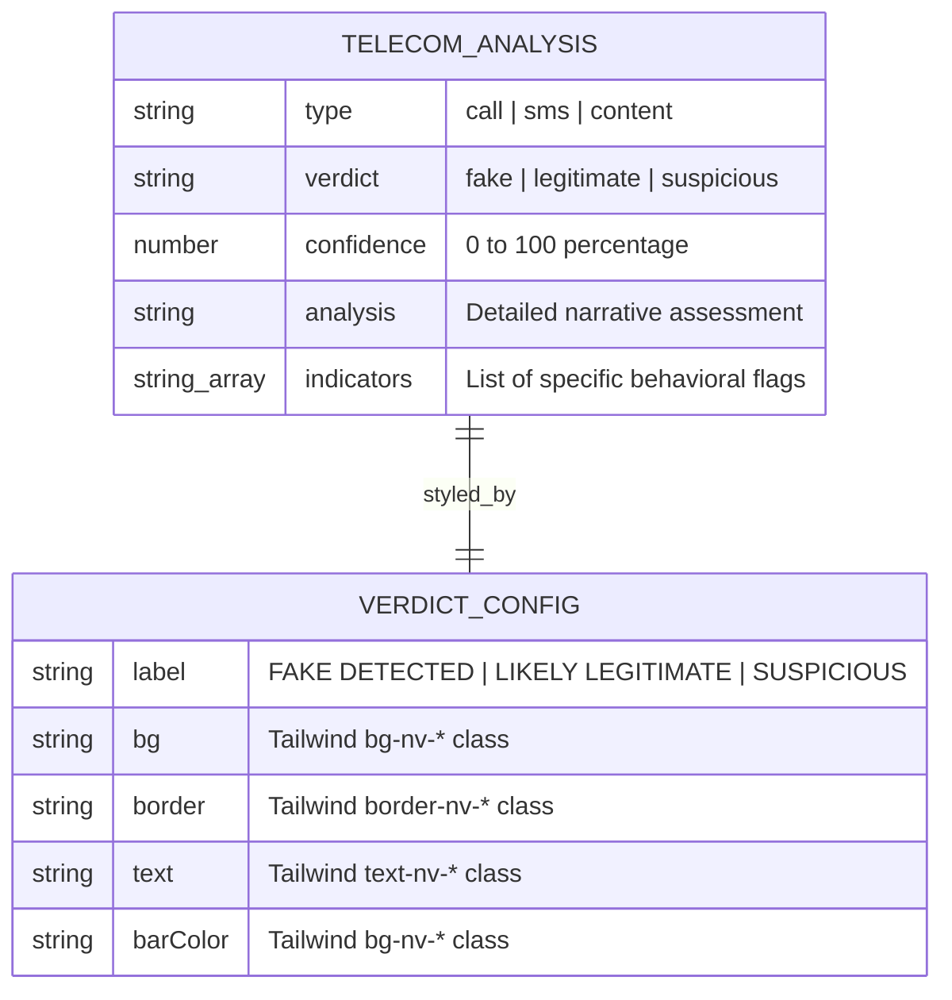
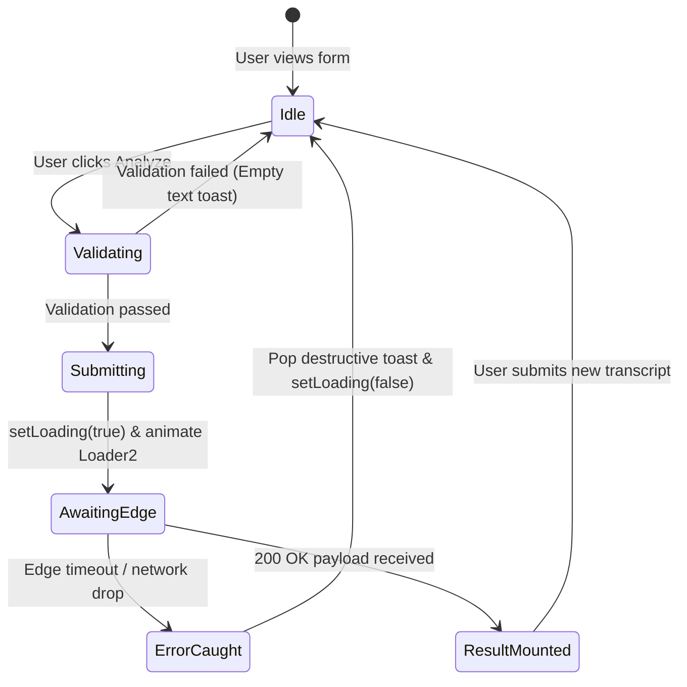

# F3: DeepGuard Scam Call & SMS Phishing Detector

## 1. Feature Identity & Behavioral Overview
* **Feature Name**: DeepGuard Telecommunications & Linguistic Fraud Classifier
* **Identifier**: `F3`
* **One-Line Description**: Detects AI-generated voice cloning scripts, social engineering pressure, urgent wire scam keywords, and SMS smishing attempts across telecommunication dialogues.
* **User-Facing Behavior**: Available on port `5182` via routes `/call-detection`, `/sms-detection`, and `/content-detection`. The investigator pastes a call transcript, text message, or article into the input area. Upon clicking "Analyze", the interface renders a loading spinner, dispatches the payload to the serverless Edge Function `analyze-content`, and displays an animated [`ResultCard.tsx`](file:///Users/avishjain/avishjain9-repos/33-codealchemist/calldetection-sms-contentdetection/src/components/ResultCard.tsx) complete with a verdict badge (`FAKE DETECTED`, `LIKELY LEGITIMATE`, `SUSPICIOUS`), numerical confidence percentage, narrative analysis, and key threat indicators.

---

## 2. Architecture & Flow Diagrams

### System Component Flowchart
```mermaid
flowchart TD
    User([Security Analyst]) --> RouteSelector{Choose Threat Channel}
    
    RouteSelector -->|Voice Transcript| CallPage[CallDetection.tsx /call-detection]
    RouteSelector -->|Smishing Message| SMSPage[SmsDetection.tsx /sms-detection]
    RouteSelector -->|Synthetic Prose| ContentPage[ContentDetection.tsx /content-detection]

    CallPage --> ValidateCall{transcript.trim() != ''}
    SMSPage --> ValidateSMS{sms.trim() != ''}
    ContentPage --> ValidateContent{content.trim() != ''}

    ValidateCall -->|Valid| InvokeEdge1[supabase.functions.invoke: analyze-content body: type='call']
    ValidateSMS -->|Valid| InvokeEdge2[supabase.functions.invoke: analyze-content body: type='sms']
    ValidateContent -->|Valid| InvokeEdge3[supabase.functions.invoke: analyze-content body: type='content']

    InvokeEdge1 --> EdgeHandler[Supabase Edge Function: analyze-content]
    InvokeEdge2 --> EdgeHandler
    InvokeEdge3 --> EdgeHandler

    EdgeHandler -->|200 OK Response| ResultState[setResult in Component State]
    ResultState --> ResultCardView[ResultCard.tsx]
    
    ResultCardView --> Badge[Render Icon: ShieldAlert / ShieldCheck / ShieldQuestion]
    ResultCardView --> ConfBar[Framer Motion Animated Confidence Bar]
    ResultCardView --> IndicatorList[Bullet List of Extracted Indicators]

    EdgeHandler -->|Error / Timeout| CatchBlock[Catch Block: toast destructive error]
```

### Full Request Lifecycle Sequence Diagram


### Forensic Result Entity Model


### State Machine Lifecycle


---

## 3. Function & Implementation Inventory

| Function Name | Location | Parameters | Return Type | Role & Implementation Details |
|---|---|---|---|---|
| `analyze` (Call) | [`calldetection/src/pages/CallDetection.tsx:L15-33`](file:///Users/avishjain/avishjain9-repos/33-codealchemist/calldetection-sms-contentdetection/src/pages/CallDetection.tsx#L15-L33) | None | `Promise<void>` | Validates `transcript`, sets loading state, invokes `analyze-content` with `type: "call"`, sets result state, or triggers error toast. |
| `analyze` (SMS) | [`calldetection/src/pages/SmsDetection.tsx:L15-33`](file:///Users/avishjain/avishjain9-repos/33-codealchemist/calldetection-sms-contentdetection/src/pages/SmsDetection.tsx#L15-L33) | None | `Promise<void>` | Validates `sms`, invokes `analyze-content` with `type: "sms"`, and binds parsed threat indicators to UI. |
| `analyze` (Content) | [`calldetection/src/pages/ContentDetection.tsx:L15-33`](file:///Users/avishjain/avishjain9-repos/33-codealchemist/calldetection-sms-contentdetection/src/pages/ContentDetection.tsx#L15-L33) | None | `Promise<void>` | Validates `content`, invokes `analyze-content` with `type: "content"`, and renders AI vs human text classification. |
| `ResultCard` | [`calldetection/src/components/ResultCard.tsx:L41-94`](file:///Users/avishjain/avishjain9-repos/33-codealchemist/calldetection-sms-contentdetection/src/components/ResultCard.tsx#L41-L94) | `result: ResultData, type: string` | `JSX.Element` | Maps verdict to visual indicators (`ShieldAlert`, `ShieldCheck`, `ShieldQuestion`), animates confidence bar using Framer Motion (`width: 0% -> confidence%`), and lists key indicators. |

---

## 4. Engineering Quality, Edge Cases & Security

* **Threat Classification Logic**:
  - `fake`: High-risk social engineering (SSN/PIN solicitations, wire transfer demands, spoofed domains). Styled with `text-nv-danger` (`#e53935`).
  - `suspicious`: Ambiguous urgency without direct malicious links or low-confidence AI text markers. Styled with `text-nv-warning` (`#f5a623`).
  - `legitimate`: Conversational tone with no fraudulent indicators. Styled with `text-nv-safe` (`#76b900`).
* **Edge Case Handling**:
  - Empty text submissions trigger immediate user feedback via `toast({ title: "Please enter...", variant: "destructive" })` before network requests are dispatched, saving bandwidth and API quotas.
* **Security & Payload Sanitization**:
  - Transcripts and message contents are submitted inside JSON bodies rather than URL parameters, avoiding credential leakage in server access logs.

---

## 5. Say It Out Loud (Spoken Interview Script)

> "In DeepGuard, located in `calldetection-sms-contentdetection/src/pages/`, I built our telecommunication fraud and linguistic scam classifier. Phishing has evolved dramatically—attackers now use generative voice cloning to impersonate executives on the phone and automated bots to blast highly tailored SMS smishing links.
> 
> Across three specialized interfaces—Call Detection, SMS Detection, and AI Content Detection—the user inputs a transcript or text message. When they click Analyze, the component validates the input and calls our Supabase Edge Function `analyze-content`, passing the modality type and text payload.
> 
> The edge function analyzes the text for psychological pressure patterns, urgency markers, and deceptive wire transfer requests. When the evaluation returns, `ResultCard.tsx` renders a color-coded verdict card: red for fake, amber for suspicious, and green for legitimate. I implemented Framer Motion to smoothly animate the confidence bar and render a bulleted breakdown of the exact risk indicators found.
> 
> I chose a serverless edge function architecture because linguistic threat patterns evolve rapidly. By keeping classification logic in serverless edge functions rather than hardcoding static regexes in the frontend, security teams can update detection models in real time without requiring client redeployments.
> 
> If the network fails, the `try-catch` block catches the exception and displays an actionable error toast while re-enabling the submission button.
> 
> One limitation is that transcripts are currently submitted as text. As a future improvement, I would connect a Web Audio API recorder to transcribe incoming audio streams directly in the browser using WebAssembly Whisper before classification."
