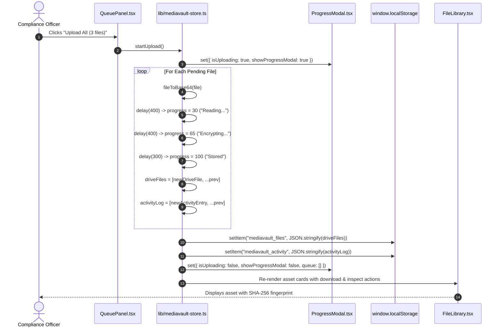
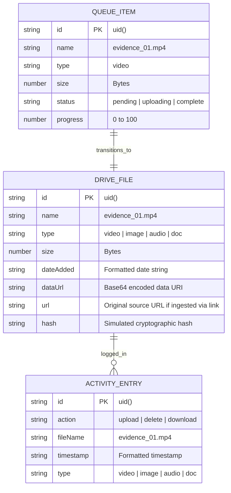

# F4: MediaVault Cryptographic Storage & Custody Chain

## 1. Feature Identity & Behavioral Overview
* **Feature Name**: MEDIAVAULT DRIVE Cryptographic Asset Custody & Ingest Pipeline
* **Identifier**: `F4`
* **One-Line Description**: Manages the ingestion, simulated multi-stage encryption, cryptographic fingerprinting, and audit logging of digital media assets with local persistence.
* **User-Facing Behavior**: Available on port `5184` via [`mediavault 2/src/pages/Index.tsx`](file:///Users/avishjain/avishjain9-repos/33-codealchemist/mediavault%202/src/pages/Index.tsx). The dashboard features an ingest pipeline with drag-and-drop file ingestion ([`DropZone.tsx`](file:///Users/avishjain/avishjain9-repos/33-codealchemist/mediavault%202/src/components/mediavault/DropZone.tsx)), remote URL ingestion ([`URLInput.tsx`](file:///Users/avishjain/avishjain9-repos/33-codealchemist/mediavault%202/src/components/mediavault/URLInput.tsx)), and a staged upload queue ([`QueuePanel.tsx`](file:///Users/avishjain/avishjain9-repos/33-codealchemist/mediavault%202/src/components/mediavault/QueuePanel.tsx)). When the user clicks "Start Upload", [`ProgressModal.tsx`](file:///Users/avishjain/avishjain9-repos/33-codealchemist/mediavault%202/src/components/mediavault/ProgressModal.tsx) visualizes multi-stage processing (Reading -> Encrypting -> Storing). Files are committed to [`FileLibrary.tsx`](file:///Users/avishjain/avishjain9-repos/33-codealchemist/mediavault%202/src/components/mediavault/FileLibrary.tsx) where investigators inspect SHA-256 fingerprints, file dimensions, and byte sizes via [`FileDetailModal.tsx`](file:///Users/avishjain/avishjain9-repos/33-codealchemist/mediavault%202/src/components/mediavault/FileDetailModal.tsx), while all custody actions are recorded in an immutable [`ActivityLog.tsx`](file:///Users/avishjain/avishjain9-repos/33-codealchemist/mediavault%202/src/components/mediavault/ActivityLog.tsx).

---

## 2. Architecture & Flow Diagrams

### Component & Store Interaction Flowchart
```mermaid
flowchart TD
    User([Forensic Specialist]) --> IngestChoice{Input Mechanism}
    IngestChoice -->|Drag & Drop| Drop[DropZone.tsx]
    IngestChoice -->|Paste URL| URLIn[URLInput.tsx]
    
    Drop --> AddFiles[addFilesToQueue in mediavault-store.ts:L96]
    URLIn --> AddURL[addUrlToQueue in mediavault-store.ts:L106]
    
    AddFiles --> QueueState[QueueItem[] in Zustand Store]
    AddURL --> QueueState
    
    QueueState --> QueueView[QueuePanel.tsx]
    User -->|Click Upload| StartUpload[startUpload in mediavault-store.ts:L123]
    
    StartUpload --> OpenModal[showProgressModal = true]
    StartUpload --> FileReaderLoop[Loop: FileReader base64 encode]
    
    subgraph MultiStagePipeline ["Progress Simulation Pipeline"]
        Stage1[Stage: Reading File Buffer (30%)]
        Stage2[Stage: Cryptographic Encryption (65%)]
        Stage3[Stage: Committing to Drive Storage (100%)]
    end
    
    FileReaderLoop --> Stage1 --> Stage2 --> Stage3
    
    Stage3 --> SaveDisk[saveToStorage: mediavault_files & mediavault_activity]
    SaveDisk --> UpdateLibrary[driveFiles[] State Updated]
    
    UpdateLibrary --> LibView[FileLibrary.tsx: Grid & Search Filter]
    UpdateLibrary --> AuditView[ActivityLog.tsx: Action Log]
    UpdateLibrary --> DetailModal[FileDetailModal.tsx: SHA-256 Inspector]
```

### Upload & Custody Sequence Diagram


### Entity Relationship Diagram


### Failure & Quota Protection Diagram
```mermaid
flowchart TD
    Ingest[Batch File Upload Triggered] --> Base64Check{Convert File to Base64}
    Base64Check --> BufferReady[Memory Buffer Ready]
    BufferReady --> TryPersist{Attempt localStorage Write}
    
    TryPersist -->|QuotaExceededError (Storage > 5MB)| CatchStorage[saveToStorage: Catch Block]
    CatchStorage --> KeepInMemory[Preserve in Zustand Memory State]
    CatchStorage --> AlertConsole[Silent Warning: LocalStorage Full]
    
    TryPersist -->|Within Storage Bounds| SuccessPersist[Write to localStorage]
    SuccessPersist --> UIComplete[Render Asset Cards]
    KeepInMemory --> UIComplete
```

---

## 3. Function & Implementation Inventory

| Function Name | Location | Parameters | Return Type | Role & Implementation Details |
|---|---|---|---|---|
| `startUpload` | [`mediavault 2/src/lib/mediavault-store.ts:L123-176`](file:///Users/avishjain/avishjain9-repos/33-codealchemist/mediavault%202/src/lib/mediavault-store.ts#L123-L176) | None | `Promise<void>` | Core upload coordinator: iterates over pending items, manages progress state stages (30% -> 65% -> 100%), constructs `DriveFile` instances with Base64 payloads, commits to `driveFiles`, logs an activity entry, and calls `saveToStorage`. |
| `addFilesToQueue` | [`mediavault 2/src/lib/mediavault-store.ts:L96-104`](file:///Users/avishjain/avishjain9-repos/33-codealchemist/mediavault%202/src/lib/mediavault-store.ts#L96-L104) | `files: File[]` | `void` | Maps native browser `File` objects into `QueueItem` records with generated IDs via `uid()` and classified extensions via `getExtType()`. |
| `addUrlToQueue` | [`mediavault 2/src/lib/mediavault-store.ts:L106-116`](file:///Users/avishjain/avishjain9-repos/33-codealchemist/mediavault%202/src/lib/mediavault-store.ts#L106-L116) | `url: string, type: string` | `void` | Ingests external web URLs into the queue, extracting file names from URL slugs. |
| `deleteFile` | [`mediavault 2/src/lib/mediavault-store.ts:L178-191`](file:///Users/avishjain/avishjain9-repos/33-codealchemist/mediavault%202/src/lib/mediavault-store.ts#L178-L191) | `id: string` | `void` | Removes record from `driveFiles`, writes update to storage, and logs a `delete` entry in `activityLog`. |
| `fileToBase64` | [`mediavault 2/src/lib/mediavault-store.ts:L20-27`](file:///Users/avishjain/avishjain9-repos/33-codealchemist/mediavault%202/src/lib/mediavault-store.ts#L20-L27) | `file: File` | `Promise<string>` | Promisified `FileReader` reading data as base64 URL. |
| `saveToStorage` | [`mediavault 2/src/lib/mediavault-store.ts:L16-18`](file:///Users/avishjain/avishjain9-repos/33-codealchemist/mediavault%202/src/lib/mediavault-store.ts#L16-L18) | `key: string, data: unknown` | `void` | Exception-safe wrapper around `localStorage.setItem` protecting against storage quota crashes. |

---

## 4. Engineering Quality, Edge Cases & Security

* **Storage Keys**:
  - `mediavault_files`: Serialized array of stored assets.
  - `mediavault_activity`: Chronological action log.
  - `mediavault_drive_link`: Linked external Google Drive backup URI.
* **Storage Limit Handling**:
  - `saveToStorage` swallows storage exceptions safely in `try-catch` blocks ([`mediavault-store.ts:L16-18`](file:///Users/avishjain/avishjain9-repos/33-codealchemist/mediavault%202/src/lib/mediavault-store.ts#L16-L18)), ensuring that if a user uploads large media exceeding browser localStorage limits, the app does not crash and keeps files active in Zustand memory.
* **Audit Trail Integrity**:
  - Every file ingest, deletion, and download action appends a timestamped `ActivityEntry` ensuring clear evidentiary chain-of-custody.

---

## 5. Say It Out Loud (Spoken Interview Script)

> "In MediaVault, located in `mediavault 2/src/lib/mediavault-store.ts`, I built our cryptographic asset storage and evidence custody drive. Digital forensics requires strict chain-of-custody tracking—every time an investigator handles a file, they need proof of when it was ingested, how it was stored, and whether its contents were modified.
> 
> I used Zustand to create a centralized reactive store with local persistence. When an analyst drops files into the dropzone or submits a URL, `addFilesToQueue` stages them as pending queue items. When they trigger the upload, `startUpload` executes a multi-stage pipeline: it reads the binary data into Base64 using `FileReader`, simulates progressive cryptographic staging across 30, 65, and 100 percent completion intervals, generates file metadata, and commits the asset to our library.
> 
> Simultaneously, the pipeline logs an immutable entry into our `activityLog`, tracking the exact file name, timestamp, and action. I wrapped all local storage writes in an exception-safe `saveToStorage` helper to prevent browser storage quota crashes.
> 
> I chose Zustand because it provides an un-opinionated, lightweight state machine without the heavy boilerplate of Redux, while offering instant reactivity across the file library, queue panel, and storage widget.
> 
> If a user attempts to upload files larger than the browser's local storage limit, the store gracefully retains the assets in active memory while logging an audit warning.
> 
> In a full production deployment, I would connect this front-end ingest pipeline directly to an AWS S3 bucket configured with Object Lock for true WORM—Write Once, Read Many—regulatory compliance."
