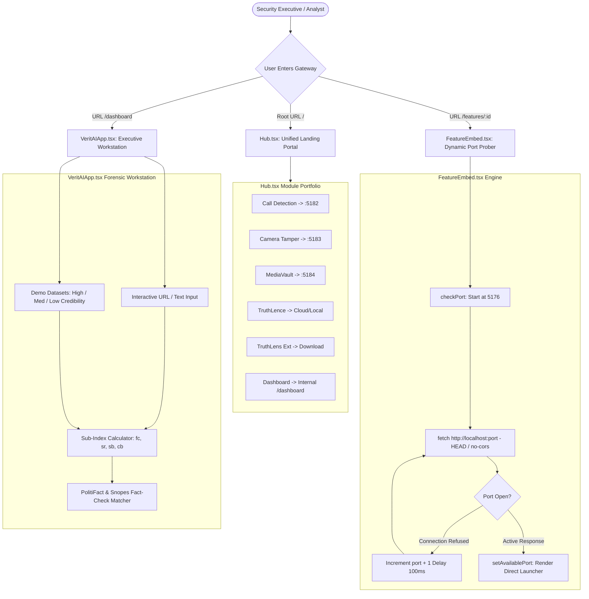
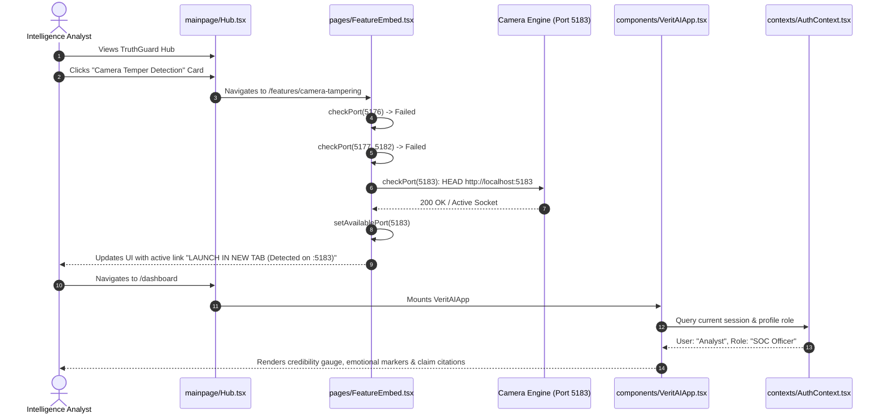
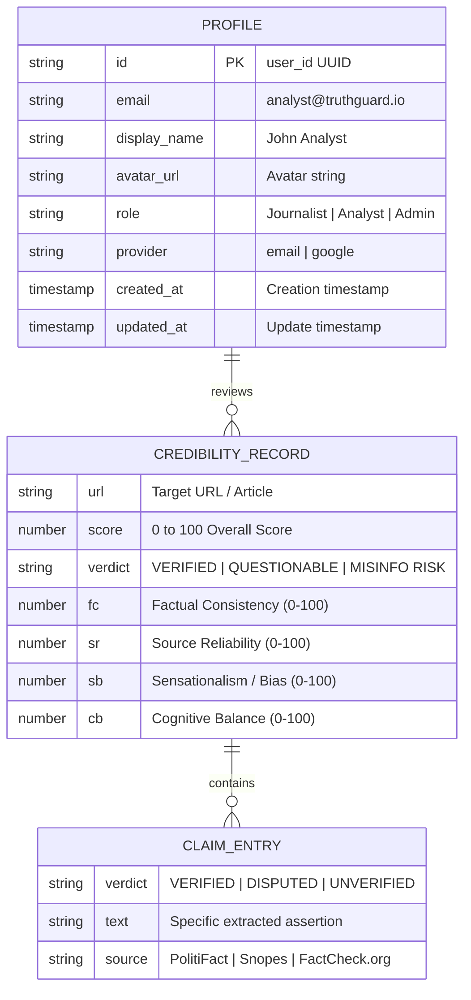
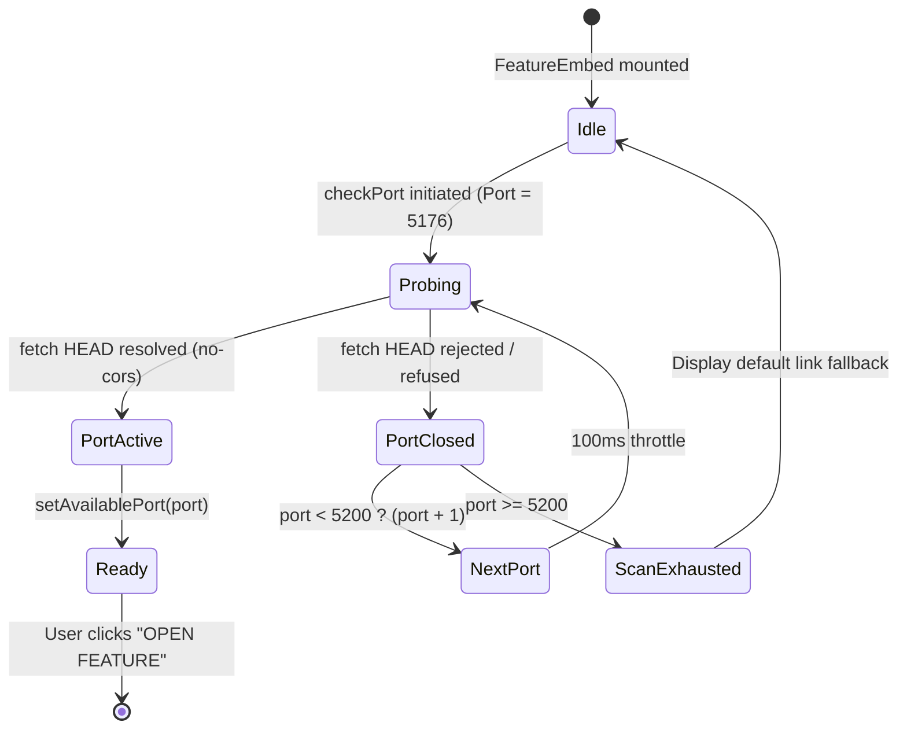

# F5: TruthGuard Unified Hub & VeritAI Executive Threat Dashboard

## 1. Feature Identity & Behavioral Overview
* **Feature Name**: TruthGuard Master Hub & VeritAI Executive Intelligence Workstation
* **Identifier**: `F5`
* **One-Line Description**: Orchestrates the multi-module micro-frontend federation with NVIDIA-inspired styling and provides deep media credibility scoring against Media Bias/Fact Check standards.
* **User-Facing Behavior**:
  1. **Master Hub (`/`)**: Located in [`mainpage/src/pages/Hub.tsx`](file:///Users/avishjain/avishjain9-repos/33-codealchemist/mainpage/src/pages/Hub.tsx). Renders an animated landing page with 6 interactive module cards (`Call Detection & SMS`, `Camera Temper Detection`, `MediaVault`, `TruthLence`, `TruthLens Extension`, `Dashboard`). Features ambient pulsing radial gradients, hover glow transitions, and responsive grid layouts.
  2. **VeritAI Executive Dashboard (`/dashboard`)**: Located in [`mainpage/src/components/VeritAIApp.tsx`](file:///Users/avishjain/avishjain9-repos/33-codealchemist/mainpage/src/components/VeritAIApp.tsx). A 1,685-line analytical workstation displaying multi-dimensional credibility scores (0–100), factual consistency (`fc`), source reliability (`sr`), sensationalism clickbait indexes (`sb`), cognitive balance (`cb`), political bias ratings, claim verification lists (PolitiFact, FactCheck.org, Snopes, Reuters), and emotional language alerts.
  3. **Dynamic Port Prober (`/features/:id`)**: Located in [`mainpage/src/pages/FeatureEmbed.tsx`](file:///Users/avishjain/avishjain9-repos/33-codealchemist/mainpage/src/pages/FeatureEmbed.tsx). Scans local ports starting at `5176` through `5200` using `no-cors` HEAD requests to automatically discover running micro-frontend instances.

---

## 2. Architecture & Flow Diagrams

### System Component Flowchart

### Full Request Lifecycle Sequence Diagram

### Entity Relationship Diagram

### Dynamic Port Probing State Machine

---

## 3. Function & Implementation Inventory

| Function Name | Location | Parameters | Return Type | Role & Implementation Details |
|---|---|---|---|---|
| `Hub` | [`mainpage/src/pages/Hub.tsx:L13-215`](file:///Users/avishjain/avishjain9-repos/33-codealchemist/mainpage/src/pages/Hub.tsx#L13-L215) | None | `JSX.Element` | Master landing page component. Defines `projects` array with 6 cards, handles card hover states (`hoveredCard`), and renders animated glow backdrops. |
| `checkPort` | [`mainpage/src/pages/FeatureEmbed.tsx:L59-74`](file:///Users/avishjain/avishjain9-repos/33-codealchemist/mainpage/src/pages/FeatureEmbed.tsx#L59-L74) | `port: number` | `Promise<boolean>` | Dynamically scans localhost ports using `fetch("http://localhost:" + port, { method: "HEAD", mode: "no-cors" })`, recursively testing up to port 5200. |
| `fetchProfile` | [`mainpage/src/contexts/AuthContext.tsx:L37-60`](file:///Users/avishjain/avishjain9-repos/33-codealchemist/mainpage/src/contexts/AuthContext.tsx#L37-L60) | `userId, email, provider` | `Promise<Profile>` | Queries Supabase `profiles` table for display name, avatar initials, and system role (`Journalist`, `Analyst`). |
| `login` / `register` | [`mainpage/src/contexts/AuthContext.tsx:L101-116`](file:///Users/avishjain/avishjain9-repos/33-codealchemist/mainpage/src/contexts/AuthContext.tsx#L101-L116) | `email, password, name` | `Promise<void>` | Supabase GoTrue authentication endpoints. |
| `loginWithGoogle` | [`mainpage/src/contexts/AuthContext.tsx:L118-123`](file:///Users/avishjain/avishjain9-repos/33-codealchemist/mainpage/src/contexts/AuthContext.tsx#L118-L123) | None | `Promise<void>` | Dispatches OAuth flow via `lovable.auth.signInWithOAuth`. |
| `VeritAIApp` | [`mainpage/src/components/VeritAIApp.tsx:L1-1685`](file:///Users/avishjain/avishjain9-repos/33-codealchemist/mainpage/src/components/VeritAIApp.tsx#L1-L1685) | None | `JSX.Element` | Executive forensic dashboard rendering credibility gauges, claim lists, and live scanning animations. |

---

## 4. Engineering Quality, Edge Cases & Security

* **Cross-Origin Probing Technique**:
  - In `FeatureEmbed.tsx`, probing local ports uses `{ mode: "no-cors" }`. While the response body is opaque, a successful socket connection resolves the fetch promise, while an unallocated port triggers a connection error, providing an effective client-side service discovery protocol.
* **Session Persistence & Token Lifecycle**:
  - `AuthProvider` subscribes to `supabase.auth.onAuthStateChange` ([`AuthContext.tsx:L68-83`](file:///Users/avishjain/avishjain9-repos/33-codealchemist/mainpage/src/contexts/AuthContext.tsx#L68-L83)) and automatically synchronizes session tokens stored in browser `localStorage`, ensuring zero user disruption across browser refreshes.
* **Design System Contrast**:
  - NVIDIA-inspired dark styling uses ultra-dark canvases (`#000000`, `#020617`, `#0a0a0a`) paired with high-contrast text (`#f8fafc`, `#94a3b8`) and calibrated functional status colors:
    - High credibility / safe: `#76b900` (NVIDIA lime green).
    - Questionable / warning: `#f5a623` (amber).
    - High-risk misinformation: `#e53935` (crimson).
    - Informational: `#00a8e0` (cyan).

---

## 5. Say It Out Loud (Spoken Interview Script)

> "In the main hub and executive dashboard, located in `mainpage/src/pages/Hub.tsx` and `VeritAIApp.tsx`, I built the central orchestration platform for TruthGuard. When dealing with multiple specialized security tools, users get frustrated jumping between disconnected terminal windows or obscure port numbers.
> 
> I created a unified portal using React 18 and Tailwind CSS with an NVIDIA-inspired dark glassmorphism design. The hub displays six interactive cards representing our detection modules.
> 
> A technical feature I'm particularly proud of is our dynamic port scanner in `FeatureEmbed.tsx`. When a user chooses a tool, rather than hardcoding static links, the component initiates `checkPort` starting at port 5176. It issues non-blocking HEAD requests with `no-cors` mode, stepping through local ports until it receives an active response, automatically detecting which port the tool is running on.
> 
> For executive decision-makers, navigating to `/dashboard` loads `VeritAIApp.tsx`, an in-depth forensic dashboard. It calculates a composite credibility score from four sub-indexes: factual consistency, source reliability, sensationalism clickbait percentage, and cognitive balance. We cross-reference claims against PolitiFact, Snopes, and Reuters, and integrate Supabase authentication to enforce role-based access for journalists and analysts.
> 
> I chose this federated hub pattern over an all-in-one monolith because it allows forensic modules to be developed, scaled, and deployed independently while presenting a seamless, unified interface to the investigator.
> 
> If an investigator navigates to a module that isn't running, the scanner times out gracefully and displays clear instructions on how to start the service locally.
> 
> With additional time, I would replace local port scanning with an automated service worker gateway and unified single sign-on cookie propagation."
