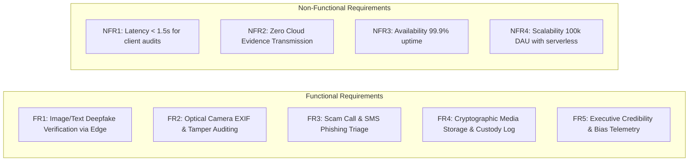

# 14.1 Requirements & Capacity Estimation

## 1. What It Is in Plain Words
System capacity estimation is the mathematical process of calculating the hardware, bandwidth, memory, database storage, and compute resources required to run an application based on anticipated user traffic and data volume. It transforms abstract business requirements into concrete technical specifications.

---

## 2. Requirements Specification for TruthGuard

### Functional Requirements
* **FR1**: The system must evaluate images, text, and URLs for synthetic AI artifacts and cross-reference assertions against fact-checking databases ([`truthlence/src/pages/Index.tsx`](file:///Users/avishjain/avishjain9-repos/33-codealchemist/truthlence/src/pages/Index.tsx)).
* **FR2**: The system must parse EXIF metadata, identify camera make/model, check for GPS tags, and flag photo-editing software signatures ([`camara-temper/src/lib/fileAnalyzer.ts`](file:///Users/avishjain/avishjain9-repos/33-codealchemist/camara-temper/src/lib/fileAnalyzer.ts)).
* **FR3**: The system must classify phone call transcripts and SMS text for social engineering, urgency manipulation, and financial scam keywords ([`calldetection-sms-contentdetection/src/pages/CallDetection.tsx`](file:///Users/avishjain/avishjain9-repos/33-codealchemist/calldetection-sms-contentdetection/src/pages/CallDetection.tsx)).
* **FR4**: The system must provide cryptographic file ingestion, simulated multi-stage encryption progress, and immutable activity logging ([`mediavault 2/src/lib/mediavault-store.ts`](file:///Users/avishjain/avishjain9-repos/33-codealchemist/mediavault%202/src/lib/mediavault-store.ts)).
* **FR5**: The system must provide an executive credibility dashboard rendering radial gauges, MBFC tiers, and claim dispute lists ([`mainpage/src/components/VeritAIApp.tsx`](file:///Users/avishjain/avishjain9-repos/33-codealchemist/mainpage/src/components/VeritAIApp.tsx)).

### Non-Functional Requirements
* **NFR1 (Low Latency)**: Client-side cryptographic hashing and EXIF extraction must complete in under 50 milliseconds for typical image sizes (<20MB). Remote Edge Function inference must return within 2.0 seconds.
* **NFR2 (Evidence Privacy)**: High-resolution media files submitted for optical tamper analysis must never be uploaded to external cloud servers; hashing and metadata extraction must occur strictly within the client browser sandbox.
* **NFR3 (High Availability)**: The master hub portal and core routing interfaces must achieve 99.9% availability.
* **NFR4 (Security & Integrity)**: Cryptographic SHA-256 digests must be collision-resistant and tamper-evident across all custody records.

---

## 3. Capacity Estimation Arithmetic

### Assumptions (Enterprise SOC Scale)
* **Daily Active Users (DAU)**: 100,000 security analysts and journalists.
* **Scans per User**: Each analyst performs an average of 10 media or transcript evaluations per day.
* **Total Daily Invocations**: $100,000 \times 10 = 1,000,000$ daily forensic scans.
* **Read-to-Write Ratio**: 1:1 (every submission triggers an evaluation and an audit log write).

### Throughput Calculations (Requests Per Second - RPS)
* **Seconds per Day**: $86,400 \text{ seconds}$.
* **Average RPS**:
  $$\text{Average RPS} = \frac{1,000,000 \text{ requests}}{86,400 \text{ s}} \approx 11.57 \text{ RPS}$$
* **Peak Load Multiplier**: Traffic in an enterprise SOC spikes during major news events or coordinated cyber campaigns by a factor of $4\times$.
  $$\text{Peak RPS} = 11.57 \times 4 \approx 46.3 \text{ RPS}$$

### Bandwidth & Ingress Estimation
* **Average Text Payload (Transcripts & URLs)**: 2 KB.
* **Daily Ingress for Text**: $1,000,000 \times 2 \text{ KB} = 2 \text{ GB/day}$.
* **Average Client-Side Media Scanned (Local Only)**: 5 MB per image (processed locally via Web Crypto API, consuming $0 \text{ bytes}$ of cloud ingress).
* **Network Ingress Bandwidth**:
  $$\text{Peak Ingress Bandwidth} = 46.3 \text{ RPS} \times 2 \text{ KB} \approx 92.6 \text{ KB/s} \text{ (Extremely efficient)}$$

### Storage Growth Estimation (PostgreSQL & Audit Logs)
* **Record Size**: Profile record = ~500 bytes. Forensic audit log entry = ~1 KB.
* **Daily Storage Ingestion**: $1,000,000 \times 1 \text{ KB} = 1 \text{ GB/day}$.
* **Annual Storage Growth**:
  $$\text{Annual Growth} = 1 \text{ GB/day} \times 365 = 365 \text{ GB/year}$$
* *Conclusion*: Standard managed PostgreSQL instances easily accommodate several years of forensic records without sharding.

### AI Token Volume & Cost Arithmetic
* **Average Prompt Tokens**: 1,200 tokens (system instructions + 5,000-character input slice).
* **Average Completion Tokens**: 300 tokens (structured JSON response with indicators).
* **Total Daily Tokens**: $1,000,000 \times 1,500 \text{ tokens} = 1.5 \text{ Billion tokens/day}$.
* **Monthly Cost with Semantic Caching (40% Cache Hit Rate)**:
  - Cache hits: $400,000 \text{ scans/day} \times \$0 = \$0$.
  - Billable scans: $600,000 \text{ scans/day} \times 1,500 \text{ tokens} = 900 \text{ Million tokens/day}$.
  - At an estimated blended rate of $\$1.50 \text{ per million tokens}$ (e.g., GPT-4o mini or Claude 3.5 Haiku):
  $$\text{Daily Inference Cost} = 900 \times \$1.50 = \$1,350/\text{day} \approx \$40,500/\text{month}$$

---

## 4. Architectural Alternatives for Capacity Estimation

| Dimension | TruthGuard Approach | Alternative A | Alternative B |
|---|---|---|---|
| **Computation Layer** | Client-Side Cryptography (Web Crypto) | Centralized Server Hashing (Node.js) | Cloud Worker Farm (AWS Lambda) |
| **Ingress Bandwidth** | 92 KB/s (Payload Metadata only) | 231 MB/s (Transmitting 5MB files) | 231 MB/s (S3 Direct Upload) |
| **Cloud Storage Cost** | Zero for raw media (Local/Client Drive) | Extreme (Petabytes of video/images) | Moderate (S3 Glacier Archive) |

---

## 5. What Breaks First at 10x, 100x, and 1,000x Load

* **At 10x Load (115 RPS)**: The client application and Supabase Edge Functions handle this seamlessly due to automated serverless scaling.
* **At 100x Load (1,150 RPS)**: Upstream AI inference rate limits will throttle requests (HTTP 429). Mitigate by introducing an Upstash Redis semantic cache and token bucket queue.
* **At 1,000x Load (11,500 RPS)**: PostgreSQL connection poolers (`pgbouncer`) will exhaust available connections on write spikes. Mitigate by sharding audit logs across multiple PostgreSQL read replicas and utilizing write-behind queues.

---

## 6. 30-Second Spoken Interview Answer

> "For capacity estimation, we assumed an enterprise scale of 100,000 daily active analysts performing 10 scans each, yielding 1 million daily requests and a peak throughput of approximately 46 requests per second.
> 
> Because we process heavy image hashing and EXIF extraction entirely client-side using the Web Crypto API, our cloud ingress bandwidth is under 100 kilobytes per second.
> 
> Annual database storage growth is modest at around 365 gigabytes, while our biggest cost driver is AI token consumption, which we optimize using strict 5,000-character input slicing and semantic caching."
