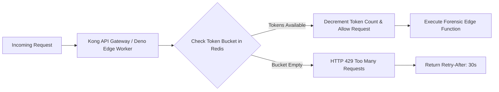

# 14.10 API Design, Versioning & Rate Limiting Algorithms

## 1. What It Is in Plain Words
API design establishes predictable, versioned communication contracts between clients and servers. Rate limiting controls how many requests a user or IP can make in a given timeframe to prevent abuse, resource exhaustion, and denial-of-service (DoS) attacks.

---

## 2. Rate Limiting Architecture in TruthGuard



---

## 3. Rate Limiting Algorithms Compared

| Algorithm | Mechanism | Burst Handling | Memory Cost | Starvation Risk | Fit with TruthGuard |
|---|---|---|---|---|---|
| **Token Bucket (Chosen)** | Tokens refill at steady rate; request takes 1 | **Handles Bursts Well** | **Minimal (2 Redis keys)**| Low | **Optimal for File Batches** |
| **Leaky Bucket** | Requests flow out at constant rate | Smooths bursts strictly | Low | Moderate | Good for network egress |
| **Fixed Window Counter** | Counts per fixed minute window | Bad at window edges ($2\times$ burst)| Minimal | High | Prone to edge spikes |
| **Sliding Window Log** | Stores timestamp of every request | Accurate | High (Memory scales with RPS)| Low | Expensive at scale |
| **Sliding Window Counter**| Blends current and previous window counts | Smooth approximation | Minimal (2 counters) | Low | Good alternative |

---

## 4. API Design Standards Applied in TruthGuard

1. **Explicit Semantic URI Naming**:
   - Resource-oriented routes: `/functions/v1/analyze-media`, `/functions/v1/analyze-content`, `/rest/v1/profiles`.
2. **Standardized Error Envelope**:
   ```json
   {
     "error": {
       "code": "RATE_LIMIT_EXCEEDED",
       "message": "Maximum of 20 forensic scans per minute reached.",
       "details": { "retryAfterSeconds": 24 }
     }
   }
   ```
3. **Cursor-Based Pagination for Custody History**:
   - Avoids high-offset SQL performance penalties:
   ```sql
   SELECT * FROM public.incidents 
   WHERE created_at < :cursor_timestamp 
   ORDER BY created_at DESC LIMIT 25;
   ```

---

## 5. 30-Second Spoken Interview Answer

> "For API design, we use resource-oriented REST endpoints returning typed JSON envelopes with standard HTTP status codes.
> 
> To protect our Edge Functions from quota exhaustion, we use a Redis-backed Token Bucket rate limiter. Unlike fixed-window counters that allow double-bursts at minute boundaries, token buckets accommodate legitimate bursts when an analyst uploads a batch of three suspect images while enforcing a hard ceiling of 20 scans per minute."
