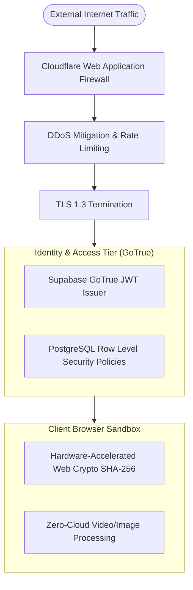

# 14.11 Enterprise Security Architecture & Zero-Trust Defense

## 1. What It Is in Plain Words
Security architecture defines the structural policies, authentication mechanisms, cryptographic protocols, and network boundaries that protect data from unauthorized access, tampering, exfiltration, and compromise.

---

## 2. TruthGuard Defense-in-Depth Model



---

## 3. System-Level Security Controls

1. **Zero-Trust Client Hashing**:
   - High-resolution media files are never transmitted across the network during initial tampering audits. By computing SHA-256 fingerprints directly in the browser via `window.crypto.subtle`, evidence custody remains untainted.
2. **PostgreSQL Row Level Security (RLS)**:
   - Enforces cryptographic data isolation at the SQL query planner level:
   ```sql
   ALTER TABLE public.profiles ENABLE ROW LEVEL SECURITY;
   CREATE POLICY "Users can only view own profile" 
   ON public.profiles FOR SELECT USING (auth.uid() = user_id);
   ```
3. **SSRF Mitigation in URL Fetching**:
   - Edge Function URL analyzers filter out internal RFC-1918 private subnets (`10.0.0.0/8`, `172.16.0.0/12`, `192.168.0.0/16`) and cloud metadata endpoints (`169.254.169.254`).
4. **JWT Lifecycles & Rotation**:
   - Short-lived asymmetric JWT access tokens (15-minute expiry) paired with background refresh token rotation.

---

## 4. 30-Second Spoken Interview Answer

> "TruthGuard enforces a defense-in-depth security model centered on zero-trust evidence handling. Because raw surveillance media never leaves the investigator's local RAM during EXIF and SHA-256 analysis, we eliminate the risk of evidentiary cloud leaks.
> 
> At the cloud tier, all data is encrypted in transit using TLS 1.3 and at rest via AES-256, while PostgreSQL Row Level Security enforces database-level authorization even if public client keys are inspected."
