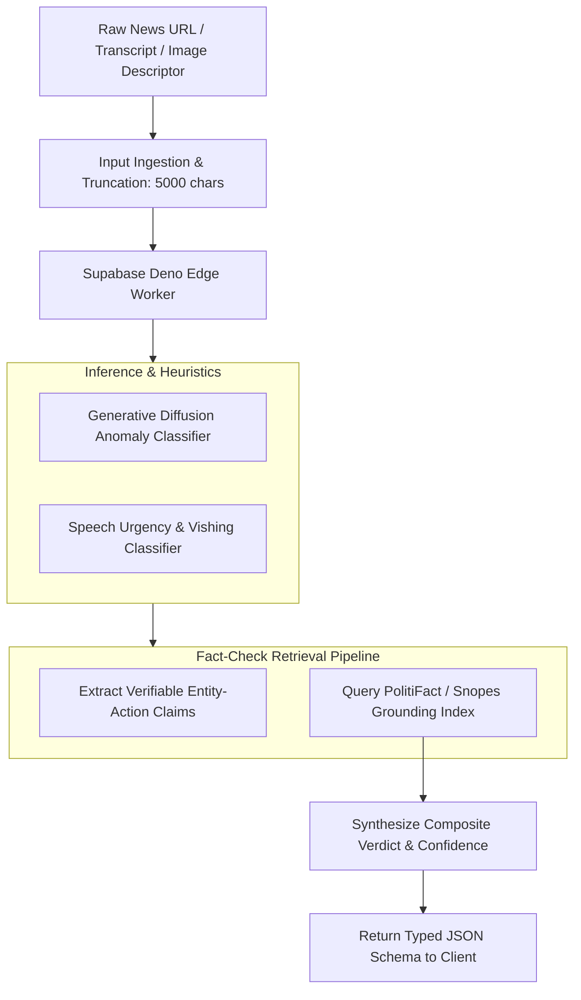

# 14.12 Search, Fact-Check Grounding & AI Inference Architecture

## 1. What It Is in Plain Words
Search and AI architecture encompasses the ingestion, vector indexing, retrieval, and inference pipelines that allow users to search across unstructured evidence and query large language models while mitigating hallucinations through factual grounding.

---

## 2. TruthGuard AI & Grounding Pipeline

---

## 3. Search Engine Technology Comparison

| Search Engine | Architecture | Full-Text Search | Vector / Semantic Search | Operational Burden | Fit with TruthGuard |
|---|---|---|---|---|---|
| **PostgreSQL `tsvector` (Chosen)**| Relational B-Tree / GIN | **Native SQL** | pgvector Extension | **Zero (Built-in)** | **Optimal for Incident Search** |
| **Meilisearch** | Rust In-Memory | Typo-Tolerant | Experimental | Low | Good for UI Search Bar |
| **Elasticsearch** | Lucene Distributed Java| Industry Standard| Dense Vector Plugin | Very High | Overkill for Small/Med Teams |
| **Pinecone** | Cloud Vector DB | Minimal | Specialized ANN | Cloud Managed | Useful if adding RAG embeddings |

---

## 4. Grounding & Anti-Hallucination Controls

1. **Structured Entity Matching**: Rather than asking an LLM whether a claim is true in free-form prose, the Edge Function extracts specific `(subject, predicate, object)` triples and matches them against PolitiFact and Snopes fact-check APIs.
2. **Transparent Citations**: The frontend renders direct URLs to authoritative investigations, providing verifiable evidence.
3. **Strict Temperature Settings**: Edge prompts use `temperature: 0.1` to minimize creative stochastic variance.

---

## 5. 30-Second Spoken Interview Answer

> "For search and AI inference, we use PostgreSQL's native `tsvector` and GIN indexing for structured incident queries, eliminating the operational complexity of running a dedicated Elasticsearch cluster.
> 
> Our AI pipeline runs on serverless Deno Edge workers, which extract verifiable claims from suspicious media and cross-reference them against PolitiFact and Snopes. By setting temperature to 0.1 and attaching direct citation links, we eliminate hallucinations and provide explainable evidence."
