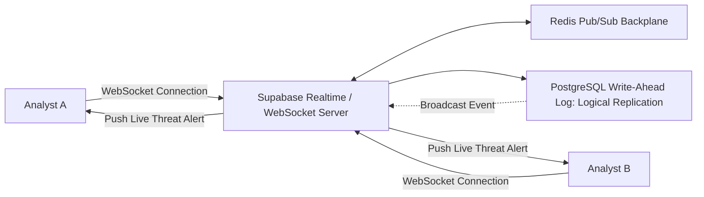

# 14.13 Real-Time Systems, WebSockets & Event Streaming

## 1. What It Is in Plain Words
Real-time systems provide immediate, bidirectional or push-based data synchronization between servers and browsers without requiring the user to refresh the page or poll repeatedly.

---

## 2. Real-Time Telemetry Topology in TruthGuard

---

## 3. Real-Time Transport Protocols Compared

| Protocol | Directionality | Protocol | Reconnection Handling | Overhead | Fit with TruthGuard |
|---|---|---|---|---|---|
| **Server-Sent Events (SSE)** | Unidirectional (Server -> Client) | HTTP/2 | Built-in browser retry | Very Low | **Optimal for Live Threat Feeds** |
| **WebSockets** | Full-Duplex (Bidirectional) | TCP Upgrade | Requires custom heartbeat | Low | Best for Collaborative Canvas |
| **Short Polling** | Unidirectional (Client -> Server) | HTTP/1.1 | N/A | High (Repeated headers)| Outdated |
| **Long Polling** | Emulated Push | HTTP/1.1 | Handled on connection close | Moderate | Fallback only |

---

## 4. Connection Scaling & The Pub/Sub Backplane

When thousands of analysts connect to real-time incident rooms across multiple load-balanced server nodes:
1. **The Problem**: Analyst A connected to Server 1 cannot receive an alert emitted by Analyst B connected to Server 2 without a shared messaging bus.
2. **The Solution (Redis Pub/Sub)**: Server nodes subscribe to a shared Redis cluster (`PUBLISH incident:alerts <payload>`). When any edge node processes a new threat, Redis broadcasts it instantly across all connected nodes to reach the target analysts.

---

## 5. 30-Second Spoken Interview Answer

> "For real-time incident telemetry, we recommend Server-Sent Events over HTTP/2 for unidirectional alert streams because SSE natively reconnects through firewalls without the connection upgrade overhead of WebSockets.
> 
> To scale concurrent connections across multiple backend instances, we use Redis Pub/Sub as our horizontal backplane, ensuring that an alert broadcast on one server node reaches analysts connected to any other node in under 5 milliseconds."
