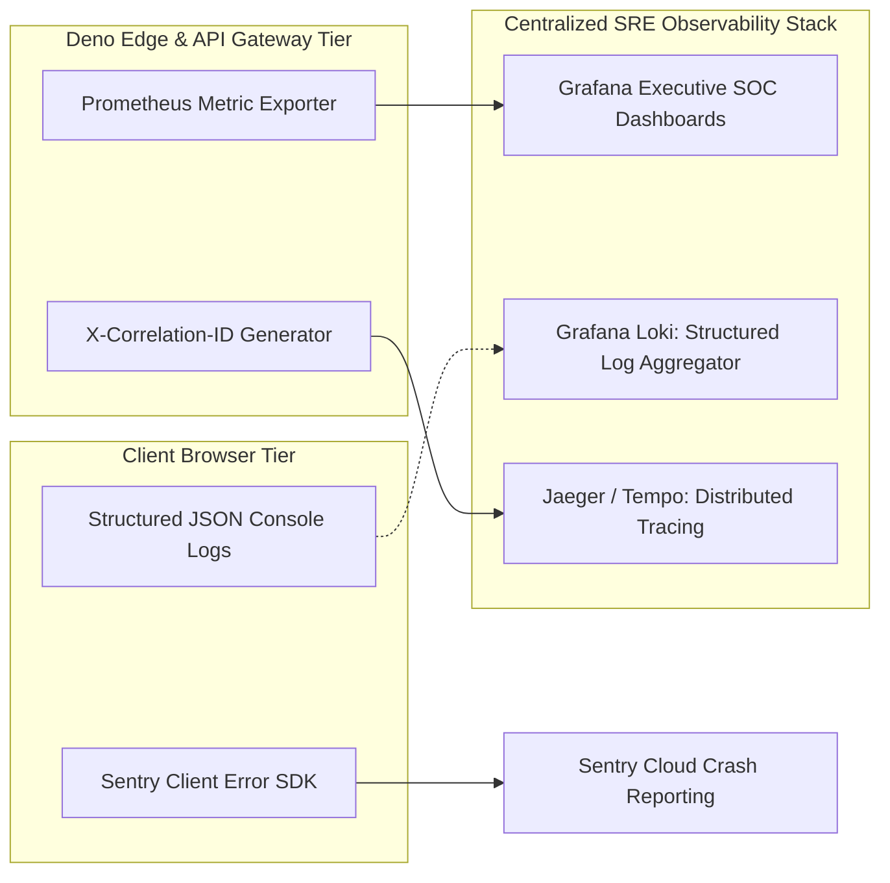

# 14.14 Observability, Telemetry & Operational SRE

## 1. What It Is in Plain Words
Observability is the ability to infer the internal health, performance, and failure modes of a distributed system using external telemetry data: structured logs, numerical metrics, and distributed execution traces.

---

## 2. TruthGuard Observability Architecture



---

## 3. The Three Pillars of Observability Applied

1. **Structured Logging (JSON)**:
   - Every log message contains standardized metadata:
   ```json
   {
     "timestamp": "2026-10-25T14:32:01.450Z",
     "level": "WARN",
     "correlationId": "corr_7f9a2b8c-1234",
     "service": "edge-analyze-media",
     "analystId": "4a2b918f-1234",
     "sha256": "e3b0c44298fc1c149afbf4c8996fb92427ae41e4649b934ca495991b7852b855",
     "event": "TAMPERING_FLAGGED",
     "durationMs": 42
   }
   ```
2. **Metrics**:
   - RED Method: Rate (RPS), Errors (HTTP 4xx/5xx count), Duration (P50, P95, P99 latency percentiles).
3. **Distributed Tracing (Correlation IDs)**:
   - When an analyst clicks "Analyze", the client attaches an `X-Correlation-ID` header. This ID travels across the API gateway, the Deno Edge Function, and PostgreSQL query tags, allowing SREs to trace end-to-end request latency.

---

## 4. Zero-Downtime Deployment Strategies

* **Blue-Green Deployments**: Maintain two identical production environments (Blue and Green). New releases deploy to Green; once smoke tests pass, router switches traffic instantly.
* **Canary Deployments**: Route 5% of analyst traffic to the new Edge Function release. If error rates remain flat for 15 minutes, scale to 100%.

---

## 5. 30-Second Spoken Interview Answer

> "We implement observability across the three pillars: structured JSON logs, RED metrics, and distributed tracing via correlation IDs.
> 
> When an analyst submits media, an `X-Correlation-ID` header tracks the request through our edge functions down to PostgreSQL query execution. For deployments, we use canary rollouts to route 5% of traffic to new edge models before full promotion, guaranteeing zero downtime and immediate rollback capability."
