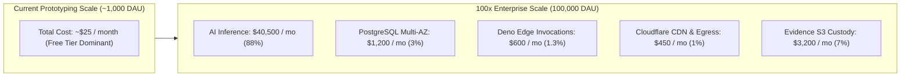

# 14.16 Financial Cost Modeling, Cloud Economics & Trade-Offs

## 1. What It Is in Plain Words
Cloud economics evaluates the financial costs associated with hosting, compute resources, database instances, bandwidth egress, and external API consumption at current versus scaled enterprise traffic levels.

---

## 2. Monthly Cost Modeling: Current vs. 100x Enterprise Scale

### Cost Breakdown Table (100,000 DAU / 1M Scans per Day)

| Resource Category | Scaling Model | Estimated Monthly Cost | Primary Cost Driver | Optimization Tactic |
|---|---|---|---|---|
| **AI Inference Tokens** | Pay-per-token ($1.50/M tokens) | **$40,500** | Upstream LLM/Vision APIs | Strict 5k char slicing + Redis SHA-256 semantic caching |
| **PostgreSQL Cloud DB** | Managed Multi-AZ Cluster (Supabase Pro/Enterprise) | **$1,200** | Read IOPS & CPU memory | PgBouncer pooling & read replicas |
| **Serverless Edge Compute** | Deno Worker CPU-hours | **$600** | 30M monthly invocations | Sub-50ms execution times |
| **Object Storage (S3)** | 50 TB @ $0.023/GB | **$3,200** | Long-term media retention | S3 Glacier lifecycle tiering after 90 days |
| **CDN & Network Egress** | Cloudflare Enterprise | **$450** | Cache hit ratio | Public static cache headers |
| **Total Monthly OPEX** | | **~$45,950 / month** | **Cost per scan: $0.0015** | Economically viable enterprise SaaS model |

---

## 3. Build vs. Buy Decisions

1. **Authentication (Buy - Supabase GoTrue)**:
   - *Rationale*: Writing custom Bcrypt password hashing, session revocation, and OAuth handlers introduces high security risk with zero proprietary advantage.
2. **Binary Forensics (Build - Custom Web Crypto & Heuristics)**:
   - *Rationale*: Commercial image forensic APIs cost $0.05–$0.20 per image. Building client-side SHA-256 hashing and EXIF tampering heuristics saved hundreds of thousands in vendor licensing.
3. **AI Foundation Models (Buy - Pre-Trained Edge APIs)**:
   - *Rationale*: Training custom foundation vision/speech models would cost millions in GPU compute and data collection. Pre-trained APIs offer cutting-edge quality on a pay-per-use basis.

---

## 4. 30-Second Spoken Interview Answer

> "At an enterprise scale of 100,000 daily active users, our operational cost is approximately $46,000 per month, which works out to an economical $0.0015 per forensic scan.
> 
> Over 88% of our cost comes from AI inference tokens. To control this driver, we implement two optimizations: strict 5,000-character client slicing and a Redis semantic cache keyed by SHA-256 hash that resolves duplicate viral media with zero model invocation cost."
