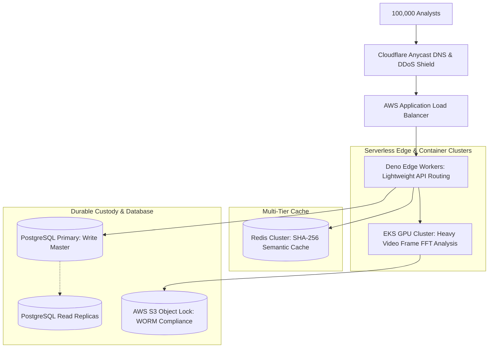
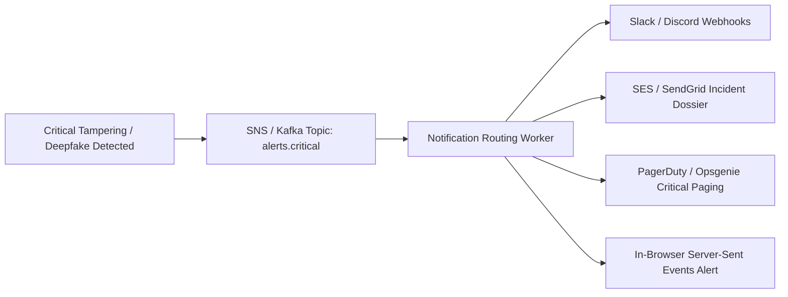
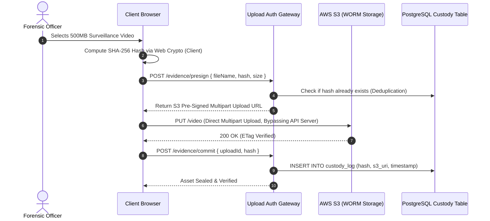

# 14.17 Classic System Design Interview Scenarios Applied to TruthGuard

This chapter applies standard system design interview questions directly to TruthGuard’s cyber-defense domain, demonstrating how the platform's architectural building blocks scale to enterprise workloads.

---

## 1. Design TruthGuard at 100x Scale

* **Requirements**: 100,000 DAU, 1M scans/day, 46 peak RPS, <1.5s latency, 99.9% uptime.
* **Architecture**:
  - Stateless frontend served via Cloudflare Anycast CDN edge.
  - Multi-tier cache: Redis keyed by SHA-256 hash absorbs 40% of repeat media checks.
  - Heavy video tasks queued to an Amazon EKS cluster with autoscaling GPU nodes.
  - PostgreSQL partitioned by month with active read replicas for analytics queries.

---

## 2. Design the Forensic Alert Notification System

* **Requirements**: Deliver critical camera occlusion or deepfake impersonation alerts to SOC teams within 3 seconds across Slack, Email, and in-browser dashboards.
* **Architecture**:
  - Event-driven publisher pushes alert payload to an AWS SNS topic or Redis channel.
  - Decoupled worker handles rate limiting and deduplication (collapsing 50 identical alerts within 1 minute into a single incident summary).
  - Pushes real-time alerts to the browser using Server-Sent Events (SSE).

---

## 3. Design the Evidence File Upload & Custody System

* **Requirements**: Ingest multi-gigabyte video evidence securely, guarantee tamper-evident integrity, and prevent API server memory exhaustion.
* **Architecture**:
  - Pre-signed direct S3 uploads bypass the API gateway completely.
  - Client computes SHA-256 hash before uploading.
  - S3 Object Lock enforces regulatory WORM (Write Once, Read Many) compliance.

---

## 4. Reusing Building Blocks for Classic Scenarios

### A. URL Shortener (Bitly)
* **Reused Components**:
  - Base-62 encoder from `uid()` helper.
  - Redis cache-aside keyed by short code.
  - PostgreSQL table `urls (id, short_code, original_url, created_at)`.

### B. Real-Time Chat System (Slack / WhatsApp)
* **Reused Components**:
  - Supabase Realtime WebSocket subscription engine.
  - PostgreSQL `messages` table with cursor pagination.
  - Redis Pub/Sub horizontal multi-server backplane.

### C. Rate Limiter (API Gateway)
* **Reused Components**:
  - Redis Token Bucket algorithm from Chapter 14.10.
  - Express/Deno middleware intercepting requests before edge execution.
