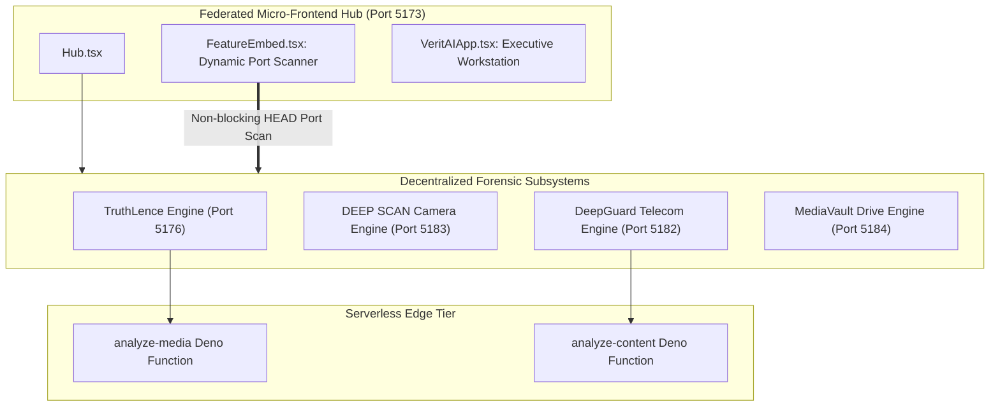

# 14.2 Architecture Styles & Federation Topology

## 1. What It Is in Plain Words
An architecture style is the foundational pattern used to organize an application's code, runtime boundaries, and communication paths. It dictates whether code runs as a single unified process (monolith), distributed microservices, ephemeral cloud functions (serverless), or decentralized frontend applications (micro-frontends).

---

## 2. TruthGuard Architectural Paradigm

TruthGuard utilizes a **Federated Micro-Frontend Architecture** coupled with **Serverless Edge Function Gateways**. Rather than building a monolithic web application, each specialized forensic modality (TruthLence, DEEP SCAN Camera, DeepGuard Telecom, MediaVault) runs as an autonomous Vite single-page application coordinated by the central Hub (`mainpage`).

---

## 3. Comparison Across Architecture Styles

| Architecture Style | Coupling Level | Build Complexity | Failure Isolation | Scalability | Local Dev Ergonomics | Fit with TruthGuard |
|---|---|---|---|---|---|---|
| **Federated Micro-Frontends (Chosen)** | **Loose** | **Low** | **Complete** | **Independent per tool** | **High (Port-based)** | **Optimal** |
| **Monolithic Single-Page App** | Tight | Low | Zero (One error crashes app) | Unified only | Fast start | Poor (Bundle bloat) |
| **Single-SPA Monorepo** | Moderate | High | Moderate (Shared window) | High | Complex | Moderate |
| **Microservices Backend (Node/Docker)**| Loose | High | High | Independent per service | Heavy (Many containers)| Overkill for client forensics |
| **Serverless Monolith (Next.js SSR)** | Moderate | Moderate | High | Automatic | Moderate | Poor (Cold starts) |

---

## 4. Trade-Offs Accepted

* **Benefit: Complete Fault Isolation**: If an investigator uploads an abnormal file that crashes the DEEP SCAN camera parser, the Hub and MediaVault continue operating without disruption.
* **Benefit: Independent Tech Stacks**: MediaVault can use Zustand for state management while VeritAI uses React Context, without dependency collisions.
* **Trade-Off: Duplicate Browser Heap**: Running multiple micro-frontends simultaneously consumes more RAM than a single shared bundle.
* **Trade-Off: Cross-Application State**: State sharing must rely on browser storage (`localStorage`) or query parameters rather than in-memory pointers.

---

## 5. How a Senior Engineer Would Improve It for Enterprise

1. **Unified Reverse Proxy Routing**: Replace local port scanning with an NGINX or Envoy reverse proxy routing path-based subdomains (`/truthlence`, `/camera`, `/vault`).
2. **Shared Component Design Tokens**: Publish the NVIDIA design system as a versioned npm package (`@truthguard/design-system`) to guarantee 100% token synchronization.
3. **Web Worker Threading**: Move CPU-heavy binary parsing off the main thread into dedicated background workers.

---

## 6. 30-Second Spoken Interview Answer

> "I chose a federated micro-frontend architecture backed by serverless Edge Functions over a traditional monolithic React app. In a digital forensics suite, modularity and failure isolation are critical: if the camera tamper analyzer crashes on a corrupted EXIF header, the investigator's active evidence custody drive in MediaVault must not be terminated.
> 
> Our central Hub coordinates independent engines using a client-side port prober, allowing each tool to be built, tested, and scaled autonomously."
