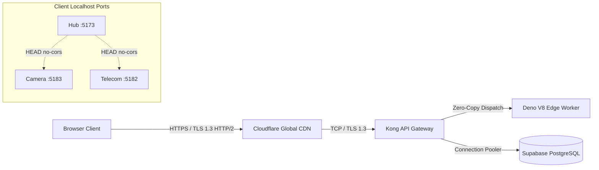

# 14.3 Networking, Protocols & Inter-Service Communication

## 1. What It Is in Plain Words
Networking in distributed systems governs how data travels across the physical and logical boundaries between user browsers, edge gateways, internal services, and cloud databases. It defines protocol choices, transport layers, encryption handshakes, and caching proxies.

---

## 2. TruthGuard Network Topography & Protocols

### Communication Protocols Applied
1. **HTTP/2 over TLS 1.3**: Used for all communication between the browser and Supabase Cloud. Enables multiplexing multiple requests over a single TCP connection, eliminating head-of-line blocking.
2. **Client-Side Dynamic Port Discovery (`HEAD / no-cors`)**: Implemented in [`FeatureEmbed.tsx:L59-74`](file:///Users/avishjain/avishjain9-repos/33-codealchemist/mainpage/src/pages/FeatureEmbed.tsx#L59-L74) to probe local micro-frontend instances without downloading payload bodies.
3. **Synchronous REST JSON**: Edge Functions communicate via request-response JSON bodies adhering strictly to typed TypeScript interfaces.

---

## 3. Protocol Comparison Matrix

| Protocol | Transport | Latency | Multiplexing | Browser Support | Use in TruthGuard |
|---|---|---|---|---|---|
| **HTTP/2 (Chosen for APIs)** | TCP | Low (~30ms) | Yes (Streams) | Universal | **API & Edge Invocations** |
| **HTTP/3 (QUIC)** | UDP | Ultra-Low (~15ms) | Yes (Independent) | Modern Browsers | Supported via Cloudflare CDN edge |
| **HTTP/1.1 (Local Dev)** | TCP | Moderate (~80ms) | No (Pipelining flawed)| Universal | Used for local Vite dev servers |
| **WebSockets** | TCP | Real-Time (<5ms) | Bi-directional | Universal | Planned for multi-analyst live feeds |
| **gRPC (HTTP/2 Protobuf)**| TCP | Minimal (~10ms) | Binary Multiplex | Requires gRPC-Web | Overkill for JSON browser interfaces |

---

## 4. What Breaks Under Extreme Network Load

* **At 10x Load**: Standard HTTP/2 multiplexing easily absorbs load without connection bottlenecks.
* **At 100x Load**: Cloudflare CDN absorbs static bundle traffic. Kong API gateway connection poolers become the constraint for database transactions.
* **At 1,000x Load**: TCP socket exhaustion at the database layer. Requires shifting from TCP-based pooling to stateless HTTP-based connection proxying.

---

## 5. 30-Second Spoken Interview Answer

> "For networking, we use HTTP/2 over TLS 1.3 for all Supabase API and Edge Function traffic, taking full advantage of stream multiplexing to prevent head-of-line blocking.
> 
> Locally, our Hub uses a lightweight discovery mechanism issuing non-blocking HTTP HEAD requests with `no-cors` mode to probe micro-frontend ports from 5176 to 5200. This verifies socket connectivity in milliseconds without downloading redundant HTML or JavaScript assets."
