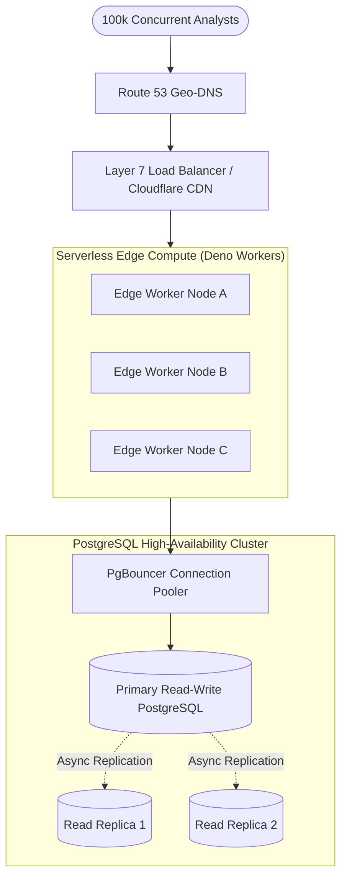

# 14.4 Load Balancing, Autoscaling & Fault Tolerance

## 1. What It Is in Plain Words
Load balancing is the technique of distributing incoming network traffic across multiple backend servers to prevent any single server from becoming overwhelmed. Horizontal scaling adds more machines to the pool, while autoscaling dynamically adjusts server capacity based on real-time traffic spikes.

---

## 2. Load Balancing Architecture in TruthGuard

---

## 3. Load Balancing Strategy Comparison

| Algorithm | Mechanism | Best Use Case | Fit with TruthGuard |
|---|---|---|---|
| **Round Robin** | Cycles requests evenly sequentially | Uniform stateless workloads | Good for static assets |
| **Least Connections** | Routes to server with fewest active connections | Long-running queries / transfers | **Optimal for AI inference** |
| **IP Hash (Sticky)** | Maps client IP to a specific backend | Stateful session persistence | Unnecessary (Stateless JWTs) |
| **Weighted Round Robin** | Allocates proportionally based on hardware specs | Heterogeneous server clusters | Moderate |

---

## 4. Single Points of Failure (SPOF) & Remediation

1. **SPOF 1: Primary PostgreSQL Database Node**:
   - *Risk*: Hardware failure on the primary database crashes user authentication and profile lookups.
   - *Remediation*: Configure multi-AZ failover with hot standby read replicas.
2. **SPOF 2: Upstream Pre-Trained AI Inference Provider**:
   - *Risk*: If OpenAI or Anthropic suffers an outage, edge functions fail.
   - *Remediation*: Implement multi-provider fallback routing—if primary AI provider times out after 3 seconds, automatically route request to a secondary provider (e.g., Anthropic -> Groq Llama 3).
3. **SPOF 3: Single Local Port Host in Development**:
   - *Risk*: Terminating the `camara-temper` terminal window breaks camera forensics.
   - *Remediation*: Our dynamic port prober automatically falls back to an informative screen guiding the user to restart the process.

---

## 5. 30-Second Spoken Interview Answer

> "For load balancing, TruthGuard relies on Layer 7 reverse proxies managed via Cloudflare and Supabase Kong. Because our architecture is completely stateless—using JWTs rather than sticky in-memory sessions—any edge worker can handle any analyst's request.
> 
> To remove single points of failure, we implement asynchronous read replicas for PostgreSQL and design our Edge Functions with multi-provider fallbacks so that an outage at one AI vendor automatically fails over to an alternative provider."
