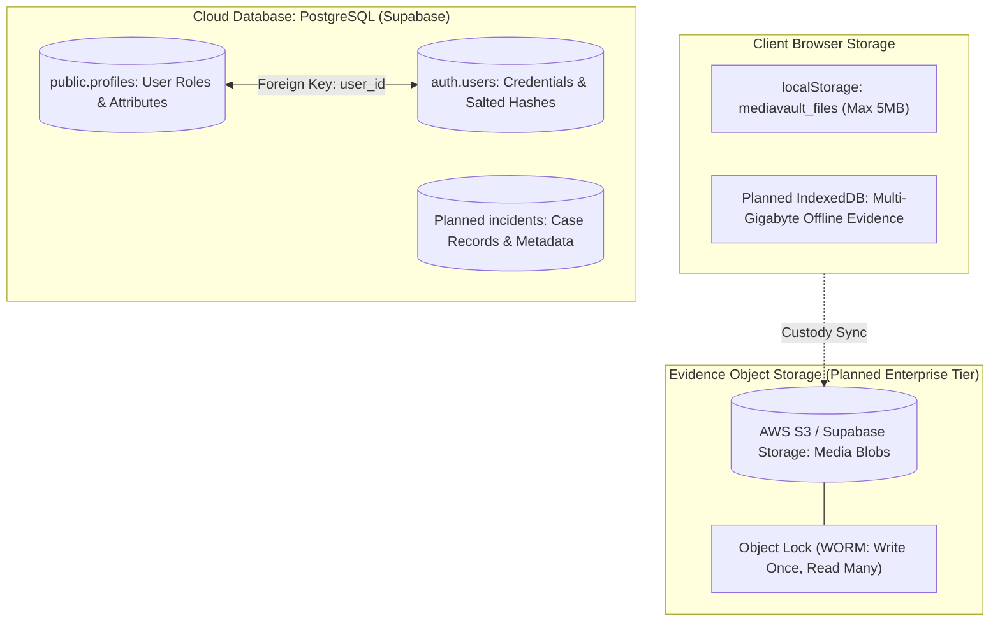

# 14.5 Databases, Persistent Storage & Evidentiary Custody

## 1. What It Is in Plain Words
Database and storage architecture determines how an application persists, indexes, retrieves, and protects data over time. In digital forensics, storage systems must balance structured relational integrity (user permissions, audit trails) with high-capacity immutable object custody (videos, images, binary hashes).

---

## 2. TruthGuard Storage Topology

---

## 3. Database Engine Comparison Matrix

| Engine | Data Model | ACID Compliance | Horizontal Scaling | Query Language | Best Use in TruthGuard |
|---|---|---|---|---|---|
| **PostgreSQL (Chosen)** | Relational | **Full (Strict)** | Read Replicas | SQL | **Profiles, Audit Logs, Case Integrity** |
| **MongoDB** | Document JSON | Document-level | Native Sharding | MQL | Good for flexible incident logs |
| **DynamoDB** | Key-Value / Doc | Eventual / Strong | Native Auto-scale | Dynamo API | High-throughput sensor streams |
| **CockroachDB** | Distributed SQL | Full (Serializable)| Native Multi-Master| SQL | Multi-region global compliance |
| **Redis** | In-Memory K-V | Minimal (RDB/AOF) | Cluster Sharding | Redis Commands | Deduplication & Semantic Cache |
| **IndexedDB** | In-Browser NoSQL| Transactional | Local Machine | JS Cursor API | Large client evidence storage |

---

## 4. CAP & PACELC Theorem Evaluation

TruthGuard’s relational data sits squarely as a **CP system** (Consistency over Availability during network partitions) under the CAP theorem:
* **Consistency Priority**: In a forensic cyber-defense system, having two analysts observe conflicting role definitions or divergent audit timestamps is unacceptable. PostgreSQL enforces strong serializability and immediate consistency.
* **PACELC Classification**: Under the PACELC theorem, TruthGuard is **PC/EC** (Partition: Consistency over Availability; Else: Consistency over Latency). The platform prioritizes exact evidentiary accuracy over millisecond response latency.

---

## 5. 30-Second Spoken Interview Answer

> "For persistent storage, TruthGuard pairs PostgreSQL for structured relational data with client-side storage for active evidence. We chose PostgreSQL because digital forensics requires strict ACID guarantees and Row Level Security to protect analyst profiles and evidence custody trails.
> 
> Under the CAP theorem, we deliberately prioritize Consistency over Availability (CP) because evidentiary records can never allow dirty reads or split-brain inconsistencies."
