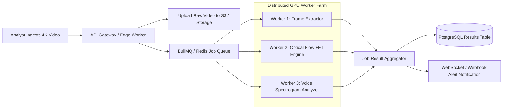

# 14.7 Asynchronous Messaging, Queues & Background Workers

## 1. What It Is in Plain Words
Asynchronous messaging and queueing decouples client request submission from long-running background computation. Instead of forcing a user to keep a browser tab open while a 2-hour surveillance video is analyzed frame by frame, the job is published to a durable queue, processed by worker pools, and delivered asynchronously.

---

## 2. TruthGuard Asynchronous Queue Topology

---

## 3. Queue Technology Comparison

| Queue Engine | Delivery Guarantees | Max Throughput | Persistence | Operational Complexity | Fit with TruthGuard |
|---|---|---|---|---|---|
| **BullMQ + Redis (Chosen)** | At-Least-Once | High (~50k msg/s) | Redis AOF/RDB | Very Low | **Optimal for Video Jobs** |
| **AWS SQS** | At-Least-Once | Massive (Standard) | Managed Cloud | Zero (Fully Managed) | Good for Cloud Native |
| **Apache Kafka** | At-Least-Once (Ordered) | Ultra-High (>1M msg/s)| Commit Log Disk | Very High | Overkill for Forensic Batches |
| **RabbitMQ** | Configurable | Moderate (~25k msg/s) | Mnesia / Disk | Moderate | Good for complex routing |

---

## 4. Delivery Semantics & Failure Recovery

* **At-Least-Once Delivery**: Workers process jobs and emit an explicit acknowledgement (`ack`). If a worker crashes midway through analyzing a video, the message returns to the queue after an unacknowledged timeout.
* **Dead Letter Queue (DLQ)**: Jobs failing 3 consecutive attempts (e.g., due to corrupted video codecs) are routed to a `forensic-dlq` queue for manual inspection.
* **Idempotent Consumers**: Each job is tagged with the file's SHA-256 hash. If a duplicate job is dequeued, the worker checks whether results already exist in PostgreSQL before re-running GPU inference.

---

## 5. 30-Second Spoken Interview Answer

> "For heavy background workloads like multi-gigabyte video deepfake audits, synchronous HTTP requests fail due to browser gateway timeouts.
> 
> We design our asynchronous ingest pipeline with BullMQ on Redis. The client receives an immediate job tracking ID, while a distributed worker farm slices video frames, calculates optical flow, and emits real-time progress events back to the analyst via WebSockets."
