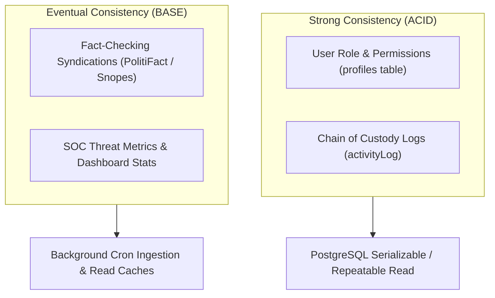

# 14.8 Consistency, Concurrency & Distributed State

## 1. What It Is in Plain Words
Consistency models define how and when updates to data become visible across all nodes and users in a distributed system. Concurrency control prevents race conditions when multiple users or processes attempt to modify the same resource simultaneously.

---

## 2. Consistency Models Applied in TruthGuard



1. **Strong Consistency for Audit Custody & Profiles**:
   - Updates to user permissions (`Journalist` -> `Analyst`) and evidence custody actions must be immediately consistent across all transactions. PostgreSQL transactions with ACID guarantees prevent dirty reads.
2. **Eventual Consistency for External Fact-Checking**:
   - Fact-checking syndications (Snopes, PolitiFact) update periodically. A 5-minute replication delay between external fact-checker releases and local cache population is fully acceptable for threat telemetry.

---

## 3. Concurrency Control & Race Condition Defenses

### Optimistic Concurrency Control (OCC)
For multi-analyst case editing, TruthGuard employs optimistic locking using an `updated_at` timestamp column:
```sql
UPDATE public.incidents 
SET status = 'investigating', updated_at = now() 
WHERE id = :id AND updated_at = :last_seen_timestamp;
```
If another analyst modified the case record concurrently, the update count returns 0, prompting the user with a conflict resolution modal rather than silently overwriting evidence notes.

### Distributed Locking for File Deduplication
When parallel ingest streams submit identical video files, a distributed Redis lock (`SET lock:hash:<sha256> true NX EX 30`) ensures only one worker initiates GPU processing, while sibling requests block until the lock releases.

---

## 4. 30-Second Spoken Interview Answer

> "We apply a hybrid consistency model tailored to forensic data requirements: strong consistency in PostgreSQL for user authorization and custody audit trails, and eventual consistency for external fact-check feed synchronizations.
> 
> To prevent race conditions during concurrent case investigations, we use optimistic concurrency control with timestamp checks, paired with distributed Redis locks to prevent duplicate GPU processing on identical file hashes."
