# System Design Deep Dive: TruthGuard Platform

Welcome to the enterprise system design deep dive for TruthGuard. This section covers all 19 system design dimensions, evaluating how the platform scales from an individual security workstation to an enterprise-wide cyber-defense platform handling millions of daily verifications.

```mermaid
flowchart TD
    SD[TruthGuard Enterprise System Design] --> Infra[Infrastructure & Topology]
    SD --> Data[Data & Cryptographic Custody]
    SD --> AI[Inference & Grounding Pipeline]
    SD --> Resil[Resilience & Security]

    Infra --> Cap[14.1 Requirements & Capacity Estimation]
    Infra --> Arch[14.2 Architecture Styles & Federation]
    Infra --> Net[14.3 Networking & Communication]
    Infra --> LB[14.4 Load Balancing & Scaling]

    Data --> DB[14.5 Databases & Storage]
    Data --> Cache[14.6 Caching & Invalidation]
    Data --> Queue[14.7 Messaging & Queues]
    Data --> Consist[14.8 Consistency & Concurrency]

    AI --> AIArch[14.12 Search & AI Architecture]
    AI --> Perf[14.15 Performance Engineering]
    AI --> Cost[14.16 Cost & Trade-Offs]

    Resil --> Rel[14.9 Reliability & Resilience]
    Resil --> Sec[14.11 Security Architecture]
    Resil --> Obs[14.14 Observability & SIEM]
```

---

## System Design Chapter Index

| Chapter | Title & Scope | Primary Topics Covered | Link |
|---|---|---|---|
| **14.1** | [Requirements & Estimation](file:///Users/avishjain/avishjain9-repos/33-codealchemist/docs/system-design/14.1-requirements-and-estimation.md) | Functional/Non-functional requirements, DAU capacity calculations, RPS arithmetic. | [Read 14.1](file:///Users/avishjain/avishjain9-repos/33-codealchemist/docs/system-design/14.1-requirements-and-estimation.md) |
| **14.2** | [Architecture Styles](file:///Users/avishjain/avishjain9-repos/33-codealchemist/docs/system-design/14.2-architecture-styles.md) | Federated Micro-Frontends vs Monolith vs Microservices. | [Read 14.2](file:///Users/avishjain/avishjain9-repos/33-codealchemist/docs/system-design/14.2-architecture-styles.md) |
| **14.3** | [Networking & Communication](file:///Users/avishjain/avishjain9-repos/33-codealchemist/docs/system-design/14.3-networking-and-communication.md) | Dynamic port discovery, HTTP/2 vs HTTP/3, TLS termination, no-cors HEAD. | [Read 14.3](file:///Users/avishjain/avishjain9-repos/33-codealchemist/docs/system-design/14.3-networking-and-communication.md) |
| **14.4** | [Load Balancing & Scaling](file:///Users/avishjain/avishjain9-repos/33-codealchemist/docs/system-design/14.4-load-balancing-and-scaling.md) | Layer 4 vs Layer 7, horizontal scaling, NGINX reverse proxy. | [Read 14.4](file:///Users/avishjain/avishjain9-repos/33-codealchemist/docs/system-design/14.4-load-balancing-and-scaling.md) |
| **14.5** | [Databases & Storage](file:///Users/avishjain/avishjain9-repos/33-codealchemist/docs/system-design/14.5-databases-and-storage.md) | PostgreSQL vs MongoDB, S3 Object Lock, client-side IndexedDB. | [Read 14.5](file:///Users/avishjain/avishjain9-repos/33-codealchemist/docs/system-design/14.5-databases-and-storage.md) |
| **14.6** | [Caching](file:///Users/avishjain/avishjain9-repos/33-codealchemist/docs/system-design/14.6-caching.md) | Redis semantic hashing cache, TanStack Query client cache. | [Read 14.6](file:///Users/avishjain/avishjain9-repos/33-codealchemist/docs/system-design/14.6-caching.md) |
| **14.7** | [Messaging & Queues](file:///Users/avishjain/avishjain9-repos/33-codealchemist/docs/system-design/14.7-messaging-and-queues.md) | Asynchronous video processing with BullMQ and AWS SQS. | [Read 14.7](file:///Users/avishjain/avishjain9-repos/33-codealchemist/docs/system-design/14.7-messaging-and-queues.md) |
| **14.8** | [Consistency & Concurrency](file:///Users/avishjain/avishjain9-repos/33-codealchemist/docs/system-design/14.8-consistency-and-concurrency.md) | Eventual consistency, ACID transactions, idempotent consumers. | [Read 14.8](file:///Users/avishjain/avishjain9-repos/33-codealchemist/docs/system-design/14.8-consistency-and-concurrency.md) |
| **14.9** | [Reliability & Resilience](file:///Users/avishjain/avishjain9-repos/33-codealchemist/docs/system-design/14.9-reliability-and-resilience.md) | Circuit breakers, graceful degradation, fallback regex heuristics. | [Read 14.9](file:///Users/avishjain/avishjain9-repos/33-codealchemist/docs/system-design/14.9-reliability-and-resilience.md) |
| **14.10** | [API Design & Rate Limiting](file:///Users/avishjain/avishjain9-repos/33-codealchemist/docs/system-design/14.10-api-design-and-rate-limiting.md) | REST design, sliding window rate limiting, pagination standards. | [Read 14.10](file:///Users/avishjain/avishjain9-repos/33-codealchemist/docs/system-design/14.10-api-design-and-rate-limiting.md) |
| **14.11** | [Security Architecture](file:///Users/avishjain/avishjain9-repos/33-codealchemist/docs/system-design/14.11-security-architecture.md) | Zero-trust evidence handling, Web Crypto SHA-256, Row Level Security. | [Read 14.11](file:///Users/avishjain/avishjain9-repos/33-codealchemist/docs/system-design/14.11-security-architecture.md) |
| **14.12** | [Search & AI Architecture](file:///Users/avishjain/avishjain9-repos/33-codealchemist/docs/system-design/14.12-search-and-ai-architecture.md) | Serverless Deno Edge inference, fact-check grounding, token budgets. | [Read 14.12](file:///Users/avishjain/avishjain9-repos/33-codealchemist/docs/system-design/14.12-search-and-ai-architecture.md) |
| **14.13** | [Real-Time Systems](file:///Users/avishjain/avishjain9-repos/33-codealchemist/docs/system-design/14.13-real-time-systems.md) | WebSockets vs SSE vs Polling for live security feeds. | [Read 14.13](file:///Users/avishjain/avishjain9-repos/33-codealchemist/docs/system-design/14.13-real-time-systems.md) |
| **14.14** | [Observability & Operations](file:///Users/avishjain/avishjain9-repos/33-codealchemist/docs/system-design/14.14-observability-and-operations.md) | Structured logging, Sentry error tracking, OpenTelemetry. | [Read 14.14](file:///Users/avishjain/avishjain9-repos/33-codealchemist/docs/system-design/14.14-observability-and-operations.md) |
| **14.15** | [Performance Engineering](file:///Users/avishjain/avishjain9-repos/33-codealchemist/docs/system-design/14.15-performance-engineering.md) | Web Vitals, Core Web Vitals, memory management, bundle splitting. | [Read 14.15](file:///Users/avishjain/avishjain9-repos/33-codealchemist/docs/system-design/14.15-performance-engineering.md) |
| **14.16** | [Cost & Trade-Offs](file:///Users/avishjain/avishjain9-repos/33-codealchemist/docs/system-design/14.16-cost-and-trade-offs.md) | Cloud unit economics: hosting, edge compute, AI token budgets. | [Read 14.16](file:///Users/avishjain/avishjain9-repos/33-codealchemist/docs/system-design/14.16-cost-and-trade-offs.md) |
| **14.17** | [Classic System Design Scenarios](file:///Users/avishjain/avishjain9-repos/33-codealchemist/docs/system-design/14.17-classic-system-design.md) | Designing TruthGuard at 100x scale, notification pipelines, search. | [Read 14.17](file:///Users/avishjain/avishjain9-repos/33-codealchemist/docs/system-design/14.17-classic-system-design.md) |
| **ADR** | [Architecture Decisions Log](file:///Users/avishjain/avishjain9-repos/33-codealchemist/docs/system-design/decisions.md) | Complete catalog of major architecture decisions (ADRs). | [Read Decisions](file:///Users/avishjain/avishjain9-repos/33-codealchemist/docs/system-design/decisions.md) |
